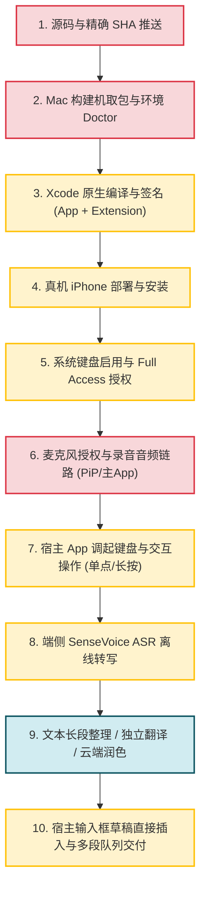
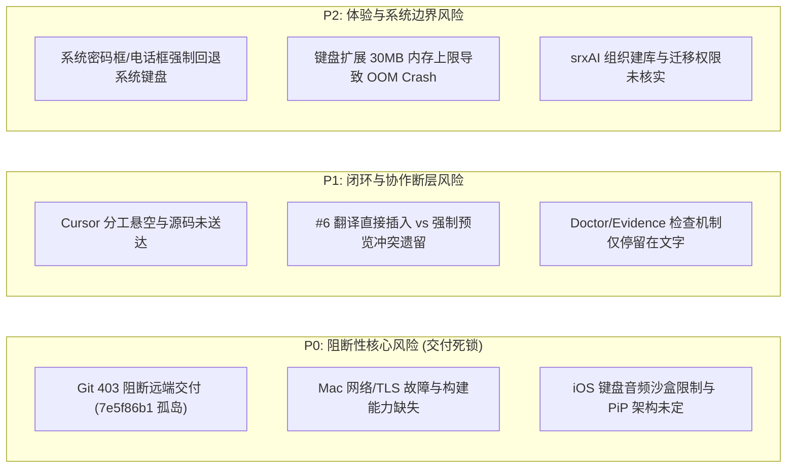
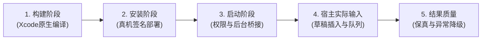

# 言出文随真实用户流程验收审查

## 0. 材料与边界

### 0.1 核查依据材料清单
本审查基于 `/workspace/agy-sprint-20261118/input` 下已收录的只读材料完成：
1. **任务索引与前置约束**：[SOURCE_INDEX.md](input/SOURCE_INDEX.md#L35-L38)（明确任务 3 言出文随为只读审查，严禁凭证输出，严禁把未闭环流程当成已完成）。
2. **工程经验库与复盘档案**：
   - [personal5_issue.md](input/voice/personal5_issue.md)（GitHub `srxAI/personal#5`：言出文随交接复盘与防重复踩坑检查清单，2026-11-14）。
   - [personal5_comments.md](input/voice/personal5_comments.md)（Comment 6872170643 关于 Doctor/Evidence 机制的待实现规则表；Comment 6872176276 关于受限环境网络误判与分层排障事实）。
3. **功能需求与验收规划 issue**：
   - [vpk1.md](input/voice/vpk1.md)（`voice-polish-keyboard#1`：参考 Typeless 交互与 OpenTypeless 经验，粤英键盘规划与 srxAI 归属）。
   - [vpk2.md](input/voice/vpk2.md)（`voice-polish-keyboard#2`：长段语音保真整理为清晰段落与列表）。
   - [vpk6.md](input/voice/vpk6.md)（`voice-polish-keyboard#6`：长按上滑独立翻译流程、直接插入草稿与 iOS 原生真机验收限制）。
   - [vpk_list.md](input/voice/vpk_list.md) 及 [search_org_yanchu.md](input/github/search_org_yanchu.md)（关联检索索引）。

---

### 0.2 本助手职责与他人认领工作边界
- **本助手角色**：只读验收审查助手（Read-only Acceptance Review Assistant）。
  - **三不原则**：不写一行实现代码、不认领任何开发任务、不编写任何重叠脚本替代他人工作。
  - **环境防线**：完全离线运行、不访问外网、不修改仓库任何文件、不执行系统变更命令、不嗅探/输出任何密钥凭据。
- **与他人认领工作的分工边界**：
  - **Codex**：负责 `voice-polish-keyboard` 核心工程实现（已在本地生成 HEAD `7e5f86b1c691f2f43a67ec6f44fc3d7f9d8da9ef`，覆盖 #1–#5 核心代码及 #6 翻译能力）；负责保全本地 bundle 并排障远端推送。
  - **Cursor**：在 #2 等待分工，拟认领 Linux 下文本保真测试 `Tests/LongFormFidelityLinux/main.swift` 与验证脚本 `scripts/check_longform_fidelity.sh`。
  - **本助手**：绝不侵入 Codex 或 Cursor 的代码与测试开发边界，仅对全链路可复现验收步骤、真实链路阻塞点、假成功风险进行系统性审查。

---

### 0.3 三分法原则（事实、未证实假说、待决策项）
- **已发生的事实**：有明确执行日志、Git SHA、退出码、issue 提交记录支撑的历史行为。
- **未证实的技术根因**：出现异常（如 Git 403、Mac TLS 错误、代理端口无响应）但尚未经分层网络诊断与凭据验证的技术推测。
- **待决策项**：涉及产品交互、架构选型、组织归属与发布权限的未定事项。

---

## 1. 真实用户流程（从唤醒/安装到在宿主键盘中实际输入并得到润色文本）逐步拆解

一个普通用户在 iPhone 上完整使用“言出文随”输入法并得到润色文本，其端到端链路共计 10 个关键步骤。各步骤的当前现状、证据状态及事实拆解如下：



---

### 步骤拆解表

| 链路步骤 | 状态标注 | 证据出处 | 事实详情、未证实根因与现状分析 |
|---|---|---|---|
| **步骤 1：源码版本化与精确 SHA 推送** | **被阻塞** | [personal5_issue.md#L16-L18](input/voice/personal5_issue.md#L16-L18)<br>[personal5_issue.md#L68](input/voice/personal5_issue.md#L68) | **【事实】**：目标分支为 `codex/voice-first-ios-keyboard`，目标提交是精确 SHA `7e5f86b1c691f2f43a67ec6f44fc3d7f9d8da9ef`。本地 bundle 完整性校验通过，但推送至 GitHub 远端时返回 HTTP 403 写入被拒，远端至今仍停留在旧 main。<br>**【未证实技术根因】**：403 的具体根因是 Git CLI 实际凭据权限不足、仓库协作权限未配置，还是代理中间人导致，尚未诊断结案。源码交付目前处于阻断状态。 |
| **步骤 2：Mac 构建机取包与环境 Doctor** | **被阻塞** | [personal5_issue.md#L19](input/voice/personal5_issue.md#L19)<br>[personal5_issue.md#L69](input/voice/personal5_issue.md#L69)<br>[personal5_comments.md#L10-L14](input/voice/personal5_comments.md#L10-L14) | **【事实】**：Mac 执行端虽在连接器上显示“在线”，但实际接入尝试返回运行状态错误；任务启动后，代码包下载和访问 GitHub 遭遇网络/TLS 错误，代理端口无响应。<br>**【未证实技术根因】**：尚未完成证书链、端口可用性与网络路由诊断，不能确定是本地代理配置错误还是网络不可达。<br>**【缺口】**：消费者机器侧校验文件可读性、bundle SHA 与构建工具链的 Doctor 检查机制尚未落地。 |
| **步骤 3：Xcode 原生工程构建与签名（App + Keyboard Extension）** | **未跑** | [personal5_issue.md#L16](input/voice/personal5_issue.md#L16)<br>[personal5_issue.md#L35](input/voice/personal5_issue.md#L35)<br>[vpk6.md#L47](input/voice/vpk6.md#L47) | **【事实】**：目前仅有 Linux 环境下的语法解析、类型检查与纯逻辑 mock 测试。未在 Mac 上使用 Xcode 对主 App 与 Keyboard Extension 执行过完整编译与签名，未记录 SDK 版本、Provisioning Profile 与构建日志。 |
| **步骤 4：iPhone 真机部署与安装** | **未跑** | [personal5_issue.md#L16](input/voice/personal5_issue.md#L16)<br>[vpk1.md#L26-L29](input/voice/vpk1.md#L26-L29)<br>[vpk6.md#L48](input/voice/vpk6.md#L48) | **【事实】**：产物从未部署到任何真实 iOS 18+ 设备上，主 App 未在物理设备上安装运行过。 |
| **步骤 5：系统设置启用键盘与“完全访问（Full Access）”授权** | **未跑** | [vpk6.md#L44](input/voice/vpk6.md#L44)<br>[vpk6.md#L48](input/voice/vpk6.md#L48) | **【事实】**：iOS 系统的“设置 → 通用 → 键盘 → 添加键盘”及开关“允许完全访问”路径未在真实设备验证；未测试在无 Full Access 时键盘扩展的警告与补救交互。 |
| **步骤 6：麦克风权限请求与音频录制链路（主 App / PiP 桥接）** | **被阻塞 / 架构待验证** | [vpk6.md#L44-L46](input/voice/vpk6.md#L44-L46)<br>[vpk6.md#L50](input/voice/vpk6.md#L50) | **【事实】**：依据 Apple 官方《Custom Keyboard Programming Guide》，键盘扩展进程处于隔离沙盒，**不能直接访问麦克风**；Full Access 不等于麦克风权限。<br>**【未证实技术根因 / 待决策项】**：Typeless 官方通过主 App + 画中画（PiP）隐藏窗口方案在后台保活录音。本项目代码中是否存在可用且合规的 PiP 录音实现完全未知；若无可用 PiP，标准 App 切换录音或桥接方案未经验证。禁止私有 API 录音或静默音频保活。 |
| **步骤 7：宿主 App 调起键盘与交互操作（单点 Speak / 长按上滑选语言）** | **未跑** | [vpk1.md#L18-L19](input/voice/vpk1.md#L18-L19)<br>[vpk6.md#L15](input/voice/vpk6.md#L15)<br>[vpk6.md#L48](input/voice/vpk6.md#L48) | **【事实】**：用户在第三方输入框调起键盘，单点 Speak 开始听写、长按 Speak 上滑选择翻译目标语言（简/繁/英）、单手模式、深浅色模式等 UI 交互，长按时长阈值与手势位移均未在真机校准。 |
| **步骤 8：端侧 SenseVoice ASR 离线转写** | **未跑** | [personal5_issue.md#L16](input/voice/personal5_issue.md#L16)<br>[vpk1.md#L14](input/voice/vpk1.md#L14)<br>[vpk2.md#L28](input/voice/vpk2.md#L28)<br>[vpk6.md#L53](input/voice/vpk6.md#L53) | **【事实】**：虽然代码声称集成 SenseVoice 粤语、普通话、英语混合离线识别，但在真实 iOS 设备内存限制（键盘扩展通常仅 30MB 左右可用内存）下，端侧模型能否加载、推理延迟如何、是否会因 OOM 被系统强杀，**全部未在真机跑过**。 |
| **步骤 9：文本长段整理 / 独立翻译 / 云端可选润色** | **已有部分证据（仅限逻辑与 Mock）**<br>+ **未跑（真机与真实模型质量）** | [vpk2.md#L24-L28](input/voice/vpk2.md#L24-L28)<br>[vpk6.md#L12](input/voice/vpk6.md#L12)<br>[vpk6.md#L33-L37](input/voice/vpk6.md#L33-L37) | **【已有证据】**：本地有基于固定文本夹具/mock provider 的规则测试（数字、人名、时限、否定词保留）。<br>**【未跑】**：`Shared/Core/PolishMode.swift` 现有 4 种模式，独立翻译状态机与目标语言选择尚未完成真机行为验证；端侧规则与真实 LLM 润色在端上的执行与延迟未跑。 |
| **步骤 10：宿主输入框草稿直接插入与多段队列交付** | **未跑** | [vpk1.md#L27-L28](input/voice/vpk1.md#L27-L28)<br>[vpk2.md#L21](input/voice/vpk2.md#L21)<br>[vpk6.md#L21](input/voice/vpk6.md#L21)<br>[vpk6.md#L52](input/voice/vpk6.md#L52) | **【事实】**：在宿主（备忘录、微信、Safari）中通过 `textDocumentProxy.insertText` 插入草稿；多段语音顺序交付；禁止自动触发发送；禁止重放旧文本；插入失败补救与原文恢复机制均未在真实宿主环境验证。 |

---

## 2. 缺口与风险（P0/P1/P2），含与他人认领工作的边界



### P0：阻断性核心风险（导致整个交付流水线彻底瘫痪）
1. **代码远端推送 403，交付基线形成孤岛**
   - **事实**：Codex 完成的提交 `7e5f86b1c691f2f43a67ec6f44fc3d7f9d8da9ef` 无法推送到 GitHub 远端分支 `codex/voice-first-ios-keyboard`，远端仍为旧提交。
   - **风险**：下游构建机、持续集成（CI）与其他开发者无法获取真实源码，任何本地“已完成”在工程上均属无效交付。
   - **未证实根因**：Git 写入凭据配置、代理穿透、SSH/HTTPS 授权未分层诊断。
   - **边界说明**：此项由 Codex 与环境负责人负责排除凭据与网络故障；本审查助手不代推代码、不改仓库写权限。
2. **Mac 构建机网络/TLS 故障与构建工具链不可用**
   - **事实**：Mac 连接仅代表心跳存活，拉包和访问 GitHub 均报 TLS/网络错误，代理端口无响应。
   - **风险**：无法产出 iOS `.app` 和 `.appex` 安装包，整个 iOS 原生验收闭环在起点即被切断。
   - **未证实根因**：Mac 节点受限网络与证书链配置未验证。
   - **边界说明**：需环境所有者介入执行分层诊断（DNS -> 代理端口 -> 证书链）；本助手不改动 Mac 系统设置。
3. **iOS 键盘扩展音频录制架构可行性未决**
   - **事实**：Apple 沙盒严禁键盘扩展直接访问麦克风。Typeless 依赖主 App + PiP（画中画）边缘悬浮后台保活。本项目是否具备可用 PiP 代码、是否会导致 App Store 审核被拒、是否会导致后台保活失效，完全未经验证。
   - **风险**：若端侧无法合规录音，整个“语音输入法”产品核心闭环无法成立。
   - **边界说明**：Codex 负责实现合规音频链路；本助手仅从验收门禁角度把关，没有真实录屏和系统录音指示点证据决不放行。

---

### P1：功能闭环与协作断层风险（导致协作冲突与交付质量失真）
1. **多开发者分工悬空与未闭环移交**
   - **事实**：Codex 在 #2 留言建议 Cursor 认领 `Tests/LongFormFidelityLinux/main.swift` 与 `scripts/check_longform_fidelity.sh`，但 Cursor 至今未明确确认，且因远端推送失败，Cursor 根本取不到 `7e5f86b1` 的代码基线。
   - **风险**：共享文件（Keyboard/Coordinator/Bridge）处于冻结等待状态，分工名存实亡，开发进度脱节。
   - **边界说明**：项目协调者应促成双向确认并提供可获取的源码基线；本助手不代写 Cursor 的测试脚本。
2. **交互规范冲突残留（直接插入 vs 强制确认）**
   - **事实**：#6 翻译流程曾出现“评论要求直接插入草稿，正文仍写强制预览”的不一致，虽正文已修正，但代码中 `Shared/Core/PolishMode.swift` 尚未完成独立翻译状态解耦。
   - **风险**：实现与验收口径不一，导致后续测试反复推翻重来。
3. **防踩坑检查机制（Doctor / Evidence）停留在文字表述**
   - **事实**：`personal#5` 评论 1 中列出的 6 项落地规则目前仅是“待实现机制”，缺乏自动化脚本与前置检查闸门。
   - **风险**：后续任务依旧会把“任务启动”、“Connected”、“本地 mock 通过”误当作进展汇报。

---

### P2：用户体验与系统边界风险（导致特定场景崩溃或体验降级）
1. **系统安全输入框与特定宿主限制**
   - **事实**：在 iOS 密码框（`isSecureTextEntry`）、电话号码输入框或主动声明拒绝第三方键盘的应用中，系统会强制切回 Apple 原生键盘。
   - **风险**：用户在密码框或受限 App 下呼不出言出文随键盘，若未提前告知与测试，会被误报为致命崩溃。
2. **键盘扩展内存限制（Memory Limit）与 OOM 崩溃**
   - **事实**：iOS 键盘扩展内存上限通常仅为 30MB 左右。SenseVoice 离线神经网络模型加载及长音频处理极易超出系统阈值。
   - **风险**：键盘在宿主中频繁白屏、闪退或被系统强制终止（Jetsam event）。
3. **组织迁移（srxAI）权限与版权审计风险**
   - **事实**：#1 计划迁移到 srxAI 组织，参考 OpenTypeless（MIT 协议）。但组织建库权限、同名冲突、仓库私有/公开属性及许可证审计尚未执行。

---

## 3. 可复现验收步骤

本验收指南覆盖软件交付的标准生命周期（构建、安装、启动、宿主实际输入、结果质量）。每一步均定义明确的前置条件、执行命令/操作、预期产物、证据形态以及失败记录规范。



---

### 3.1 构建阶段（Build Phase）
- **目标**：在经过验证的 macOS 环境中，由源码构建出未经篡改的 iOS 主 App 与 Keyboard Extension 原生二进制产物。
- **前置条件**：
  1. 验证目标代码分支为 `codex/voice-first-ios-keyboard`，精确 SHA 为 `7e5f86b1c691f2f43a67ec6f44fc3d7f9d8da9ef`。
  2. 机器环境只读检查：执行 `sw_vers`、`xcodebuild -version` 并确认 Xcode 16+ / iOS 18+ SDK 安装就绪。
- **操作步骤**：
  ```bash
  # 1. 验证源码一致性
  git rev-parse HEAD  # 预期输出必须严格为 7e5f86b1c691f2f43a67ec6f44fc3d7f9d8da9ef
  git status --porcelain  # 确认工作区无未跟踪的脏文件
  
  # 2. 调用 Xcode 原生构建命令（脱敏参数）
  xcodebuild -workspace VoicePolishKeyboard.xcworkspace \
             -scheme VoicePolishKeyboard \
             -configuration Debug \
             -destination 'generic/platform=iOS' \
             CODE_SIGNING_ALLOWED=YES \
             build
  ```
- **预期结果**：编译退出码为 `0`，生成 `VoicePolishKeyboard.app` 及 `PlugIns/VoicePolishKeyboardExtension.appex`。
- **证据形态**：构建日志脱敏摘要、产物文件 `ls -la` 列表及 SHA-256 校验和。
- **失败记录规范**：记录 Xcode 错误编号（如 `clang: error:`）、编译失败的代码行号与上下文、缺少符号/依赖的明细；**严禁**打印任何开发者证书私钥、Provisioning Profile 密文字符串。

---

### 3.2 安装阶段（Install Phase）
- **目标**：将签名的 App 与扩展正确部署到连接的 iPhone 物理测试机上。
- **前置条件**：iPhone（iOS 18+）已开启开发者模式（Developer Mode），设备已信任调试证书。
- **操作步骤**：
  ```bash
  # 使用 Apple 推荐命令行工具或 Xcode 安装到物理设备
  xcrun devicectl device install app --device <TARGET_DEVICE_ID> <PATH_TO_APP>
  ```
- **预期结果**：安装退出码为 `0`；设备主屏幕出现“言出文随”App 图标；系统设置中已识别该 App。
- **证据形态**：`devicectl` 成功输出日志；设备桌面上出现 App 图标的照片或截屏。
- **失败记录规范**：记录安装错误码（如 `0xe8008015` 证书不受信任、Bundle ID 冲突）；脱敏处理设备的真实 UDID 与个人账号信息。

---

### 3.3 启动与授权阶段（Launch & Authorization Phase）
- **目标**：完成主 App 初始化，验证麦克风权限、键盘扩展启用、“完全访问（Full Access）”授权及 App Group 共享配置。
- **前置条件**：App 安装成功，设备处于解锁状态。
- **操作步骤**：
  1. 点击启动主 App，观察是否主动弹出麦克风权限请求弹窗，点击“允许”。
  2. 打开 iOS“设置 → 通用 → 键盘 → 键盘 → 添加新键盘”，在第三方键盘列表中点击“言出文随”。
  3. 点击进入“言出文随”，打开“允许完全访问”开关，在系统安全提示框中点击“允许”。
  4. 重新切回主 App，检查状态看板中的“麦克风权限”、“Full Access 状态”、“App Group 数据通道”指示灯。
  5. 检查后台录音机制引导（如画中画 PiP 开启与折叠隐藏至屏幕边缘）。
- **预期结果**：
  - 麦克风权限状态为 `authorized`；
  - 键盘扩展完全访问状态为 `true`；
  - 主 App 与扩展之间的 App Group 容器可读写共享配置；
  - 若权限被拒，App 展现出明确的人性化引导跳转路径，而非崩溃闪退。
- **证据形态**：
  - 系统“设置 → 键盘”界面截图；
  - 主 App 内部权限就绪状态检测页截图。
- **失败记录规范**：若权限状态不同步或 IPC 桥接失败，记录 syslog 中对应子系统 `com.apple.keyboard` 与 App Group 的报错日志。

---

### 3.4 宿主实际输入阶段（Host Actual Input Phase）
- **目标**：在第三方真实 App（如 iOS 自带备忘录 Notes、微信 WeChat 或 Safari 纯文本输入框）中实际录入语音，验证听写、翻译手势及文本草稿直接插入。
- **前置条件**：前序授权全部完成，宿主 App 输入框处于聚焦编辑状态。
- **操作步骤**：
  1. **基准普通润色流程**：
     - 在宿主输入框点击调起“言出文随”键盘；
     - 单点键盘底部的 `Speak` 按钮，观察录音波形与系统录音指示点（屏幕顶部橙色圆点）；
     - 清晰口述：“明天早上十点联系供应商确认周五交货，另外预算不要超过三千块”；
     - 再次点击 `Speak` 按钮结束录音。
  2. **长按上滑独立翻译流程（#6 规范）**：
     - 长按 `Speak` 按钮（保持按压约 0.5s），向上滑动呼出目标语言面板；
     - 手指滑动选中“English”，松开/确认；
     - 口述中文：“请把样品检查报告发给项目经理”；
     - 点击 `Speak` 结束。
  3. **边界与连续输入**：
     - 连续口述两段内容，观察多段队列插入顺序；
     - 测试在录音过程中左滑取消录音。
- **预期结果**：
  - 录音过程无系统卡顿，麦克风波形平滑动画；
  - 转写与整理完成后，文本直接插入当前宿主输入框光标处，**不强制弹出全屏预览窗口**；
  - **严禁**自动触发宿主 App 的“发送”操作（仅插入草稿）；
  - 翻译结果直接以英文文本插入，多段录音严格按照口述先后顺序排队交付；
  - 取消操作后不向宿主插入任何脏文字。
- **证据形态**：
  - 全流程 iPhone 屏幕录屏（必须完整展现从唤醒键盘、录音波形、顶部橙色录音点、到文本逐段出现在宿主光标处的完整画面）；
  - 宿主输入框最终生成的文本截图。
- **失败记录规范**：若键盘出现闪退、白屏（内存超限 OOM）、文本重复插入或未插入，提取系统 CrashReporter 的 `.ips` 崩溃日志并脱敏记录崩溃线程调用栈。

---

### 3.5 结果质量与保真阶段（Result Quality & Fidelity Phase）
- **目标**：验证整理后的文本语义保真、列表结构清晰，且在断网或异常情况下具备安全降级能力。
- **前置条件**：已通过 3.4 步骤在纯文本框中插入整理后的文本。
- **操作步骤**：
  1. **语义保真度比对**：
     - 核对数字：“周五”、“3000 元/三千块”是否如实保留，无阿拉伯数字与中文数字的语义错误；
     - 核对否定约束：“不要超过”是否被篡改或遗漏；
     - 核对专有名词与代码：口述代码/英文缩写（如 API, PR, SHA）是否保持保真，未被自然语言错误纠偏；
     - 检查格式：是否在宿主纯文本框内输出了不必要的 Markdown 代码块或语法标记。
  2. **离线与断网降级验证**：
     - 开启 iPhone“飞行模式”（断开 Wi-Fi 与移动蜂窝网络）；
     - 再次口述长文本，验证端侧 SenseVoice 离线转写与端侧保守规则整理；
     - 检查云端超时或不可用时，键盘是否明确标示“离线/降级”，并允许用户一键回退/插入原始识别文本。
- **预期结果**：
  - 保真测试 100% 通过：无擅自添加的负责人、虚假日期或未经口述的承诺；
  - 纯文本框内排版清晰（自然分段、必要时编号列表），无渲染乱码；
  - 飞行模式下离线功能完全可用，无网络请求死锁，无未捕获异常，原文始终安全可恢复。
- **证据形态**：原始口述音频文本对照表、Diff 比对报告、飞行模式下成功插入草稿的截屏。
- **失败记录规范**：记录幻觉内容、被篡改的关键约束（如将“不要”改写为“必须”）、断网时的无响应时长（挂起秒数）。

---

## 4. 不能再当成已完成的假成功

结合 `srxAI/personal#5` 的深刻教训与防踩坑清单，以下 8 类在以往协作中频繁出现的现象，**在本次及后续审查中严禁当成已完成的进展**：

| 序号 | 伪成功反模式（假象） | 严禁当成已完成的原因（致命断层） | 真实合格标准 |
|---|---|---|---|
| **1** | **“Mock 测试 / 单元测试全绿”** | Linux 下纯逻辑测试、mock provider 测试完全脱离 iOS 运行时。不能证明键盘扩展在 30MB 内存上限下能运行 SenseVoice 模型，也不能证明麦克风权限与宿主插入有效。 | 必须有真实 iPhone（iOS 18+）上主 App 与 Extension 联合运行的物理录屏与日志。 |
| **2** | **“Mac 连接器显示 Connected”** | “Connected”仅仅是长连接心跳保活，不代表该机器具备构建任务执行能力。此前已发生过工具返回运行状态错误、代理端口无响应、TLS 握手失败等情况。 | 必须在 Mac 执行端实际成功运行只读命令（如 `xcodebuild -version`、文件校验和检查）并返回退出码 0。 |
| **3** | **“云端环境已清除代理环境变量”** | 清除 shell 的 `HTTP_PROXY` 不等于关闭系统透明代理，也不等于 Git 凭据正确配置；连接器身份具备 `push: true` 权限不代表 Git CLI 凭据有效。 | 必须有 Git CLI 实际验证远端写入权限并通过分层诊断的证据。 |
| **4** | **“本地原型已完成 / 本地 HEAD 提交存在”** | 本地提交（如 `7e5f86b1`）无论在本地多完好，只要因 403 推不上去，对团队、CI、下游构建机而言就是不可见的“信息孤岛”，无法消费。 | 必须通过 `git ls-remote` 验证远端分支存在且 SHA 与目标完全一致。 |
| **5** | **“在 Issue 中已向对方留言分工”** | 留言发出了不代表对方已阅读，更不代表对方已接受，更何况对方当前在远端根本拉不到代码。单向留言不能作为协作闭环依据。 | 必须有对方开发者的正式确认回复，并共同核定接口与测试入口基线。 |
| **6** | **“任务已启动 / 进程处于 Running”** | 任务启动只是消耗计算资源的开始，绝不等于阶段性里程碑达成。曾多次出现“启动后因网络卡死数小时”却被当作正在推进。 | 必须以最终退出码 0、产物哈希或阶段性产出证据作为节点结案标准。 |
| **7** | **“在 Issue 评论中澄清了新方案”** | 在评论里说明了“改为直接插入”，但 Issue 正文仍要求“强制预览确认”，规范未收敛至单一权威源，造成开发与验收撕裂。 | 规范必须完成正文收敛更新，并在代码实现与行为测试中严格回读对齐。 |
| **8** | **“复盘经验卡已写完并保存”** | 经验写在 Markdown 里并不能阻止错误重犯。若缺乏工程化 Doctor 校验脚本与前置拦截门禁，所有规则依然会被再次击穿。 | 必须将经验转化为 CI 或入口处的自动化检查工具（拒绝假成功样例，放行真实成功样例）。 |

---

## 5. 下一步建议（只读/交接，不派编码）

作为只读验收审查助手，本报告不认领开发、不分配具体编码任务，仅面向项目协调者与工程交接方提供防重复踩坑的流程建议：

### 1. 严格执行个人经验库 #5 的标准 Handoff 门禁
后续任何关于言出文随的任务派工，必须在任务描述前置注入并核对以下 10 项标准交接字段：
- 目标与验收标准（区分 unit / mock / native / device）；
- 最新用户限制与撤销方案（明确禁止自动发送、禁止强制预览、禁止私有保活）；
- 仓库、分支、精确 SHA（必须以 `7e5f86b1c691f2f43a67ec6f44fc3d7f9d8da9ef` 为基线，严禁擅自造新提交）；
- 执行端实际只读命令结果（不得仅写“connected”）；
- 阻断步骤脱敏日志与分层排障记录；
- 另一开发者的确认状态与文件边界。

### 2. 闭环 P0 阻断点：先打通交付与环境，再谈功能开发
- **Git 403 排障**：协调者应优先安排凭据与仓库写入授权排查，确保本地 bundle 完整推送到远端目标分支 `codex/voice-first-ios-keyboard`，让消费者机器能够正常拉取。
- **Mac 节点分层诊断**：按“DNS 解析 → 代理端口连通性 → TLS 证书链完整性 → 仓库访问授权”的顺序执行脱敏排障，切忌将“网络连不上”笼统推断为“账号凭据失效”。

### 3. 多开发者协作解冻建议
- 在 Cursor 能够通过 Git 正常获取代码前，继续维持核心共享文件（`Keyboard/`、`Coordinator/`、`Bridge/`）的冻结状态。
- 待远端分支推送成功后，正式向 Cursor 移交测试文件清单（`Tests/LongFormFidelityLinux/main.swift` 与 `scripts/check_longform_fidelity.sh`），并取得其双向确认。

### 4. 架构专项审查：键盘音频采集与保活合规性
- 组织一次针对 iOS 键盘录音链路的纯只读架构核对：
  - 确认主 App 与扩展之间的音频数据传输是采用 App Group 共享内存、Mach Port 还是本地 Socket 桥接；
  - 确认后台录音是依赖前台切换还是合规 PiP 机制，核查是否存在触发 App Store 封禁的私有 API 调用风险；
  - 若无可用 PiP 机制，应在产品规范中明确降级交互为“切换至主 App 录音后回切插入”，不在未验证状态下宣传无缝体验。

### 5. 落地只读校验工具（Doctor / Evidence）
- 在流水线中引入轻量只读验证机制：
  - 开工前执行消费者侧 Doctor，校验文件可读性、校验和与分支精确 SHA；
  - 交付前执行 Evidence 检查，使用 `git ls-remote` 核验远端状态。
  - 用历史失败样例（如 403 阻断、Mac TLS 错误）作为反例测试，证明检查机制确实能有效拦截“假成功”。
