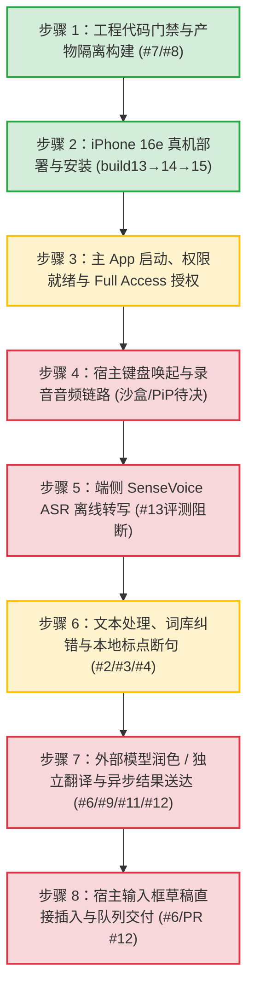
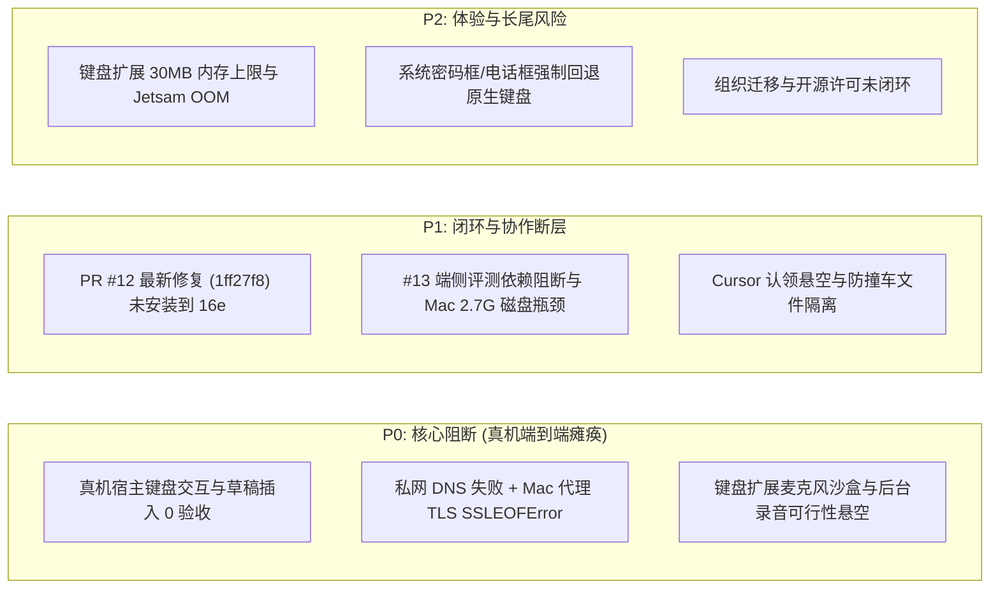
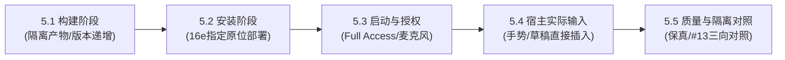
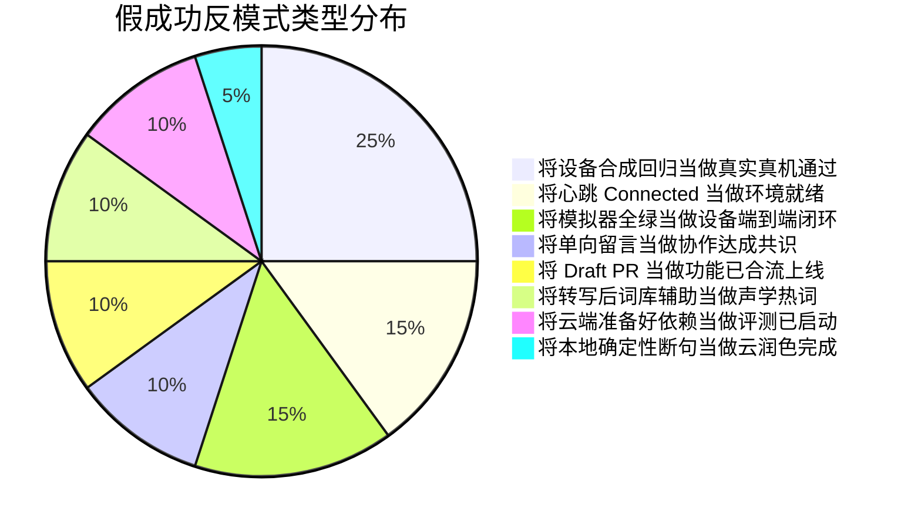

# 言出文随真实用户流程验收审查（完整版）

## 0. 材料范围与边界

### 0.1 本轮实际核查材料清单
本审查基于 `/workspace/agy-sprint-20261118/input` 下完整装入的第二轮（round2）只读材料进行全量穿透分析，涵盖：
1. **统一索引与约束**：
   - [voice-round2/INDEX.md](README.md)（round2 材料规范、只读防篡改原则、假成功红线）。
   - [round2-context/03-coordinator-review.md](review/03-coordinator-review.md)（协调者第一轮复核意见，指出上一轮仅装入 #1/#2/#6 及 交接复盘，本轮必须补全 #3–#5、#7–#11、#13 及 PR/issue #12）。
   - [round2-context/03-round1-review.md](input/round2-context/03-round1-review.md)（上一轮初步审查底稿）。
2. **Pull Requests 记录**：
   - [prs.md](https://github.com/evan188199-tech/voice-polish-keyboard/pull/12) 及 [pr-12.md](https://github.com/evan188199-tech/voice-polish-keyboard/pull/12)（PR #12 草稿基线、文件变更、build13–build15 演变及 URL 修复记录）。
3. **全部 Issues 与完整评论集**（已优先读取完整 `comments-*.md`，严格忽略简化/连接器镜像）：
   - [issue-1.md](https://github.com/evan188199-tech/voice-polish-keyboard/issues/1) 与 [comments-1.md](https://github.com/evan188199-tech/voice-polish-keyboard/issues/1)（交互基线、开源审计、图标集成）。
   - [issue-2.md](https://github.com/evan188199-tech/voice-polish-keyboard/issues/2) 与 [comments-2.md](https://github.com/evan188199-tech/voice-polish-keyboard/issues/2)（长段保真、Cursor 分工对齐、源码推送解除 403 记录、本地断句回退）。
   - [issue-3.md](https://github.com/evan188199-tech/voice-polish-keyboard/issues/3) 与 [comments-3.md](https://github.com/evan188199-tech/voice-polish-keyboard/issues/3)（口述字词纠错、拆字复核、dot 集成负责人独占边界）。
   - [issue-4.md](https://github.com/evan188199-tech/voice-polish-keyboard/issues/4) 与 [comments-4.md](https://github.com/evan188199-tech/voice-polish-keyboard/issues/4)（地名词典、模块 A 词汇上下文策略 `PolishContextPolicy`）。
   - [issue-5.md](https://github.com/evan188199-tech/voice-polish-keyboard/issues/5) 与 [comments-5.md](https://github.com/evan188199-tech/voice-polish-keyboard/issues/5)（脱敏词典、三层数据分层、草稿插入 vs 系统分享图片边界）。
   - [issue-6.md](https://github.com/evan188199-tech/voice-polish-keyboard/issues/6) 与 [comments-6.md](https://github.com/evan188199-tech/voice-polish-keyboard/issues/6)（Typeless 翻译交互、长按上滑手势、撤销强制预览改为直接插入草稿）。
   - [issue-7.md](https://github.com/evan188199-tech/voice-polish-keyboard/issues/7)（设备安装与模型导入门禁、构建产物 DerivedData 隔离、禁止自动注册设备）。
   - [issue-8.md](https://github.com/evan188199-tech/voice-polish-keyboard/issues/8)（工程护栏、只读诊断、精确分支推送核验脚本）。
   - [issue-9.md](https://github.com/evan188199-tech/voice-polish-keyboard/issues/9) 与 [comments-9.md](https://github.com/evan188199-tech/voice-polish-keyboard/issues/9)（异步任务失败送达、模块 B 契约回归、不可变任务快照与脱敏网络分类）。
   - [issue-10.md](https://github.com/evan188199-tech/voice-polish-keyboard/issues/10)（Typeless 高级功能规划与 Notion 中台路线）。
   - [issue-11.md](https://github.com/evan188199-tech/voice-polish-keyboard/issues/11)（Ubuntu 本地部署腾讯 Hy-MT2-1.8B 小模型翻译服务）。
   - [issue-12.md](https://github.com/evan188199-tech/voice-polish-keyboard/issues/12) 与 [comments-12.md](https://github.com/evan188199-tech/voice-polish-keyboard/issues/12)（build15 物理机 16e 部署、URL 兼容修复、私网 DNS 解析阻塞）。
   - [issue-13.md](https://github.com/evan188199-tech/voice-polish-keyboard/issues/13) 与 [comments-13.md](https://github.com/evan188199-tech/voice-polish-keyboard/issues/13)（iPhone 16e 端侧 ASR/标点/小模型隔离评测认领、Mac 代理 13130 TLS 握手断开、38 个依赖包未送达）。
4. **交接复盘与规则沉淀**：
   - 当时的交接记录（交接复盘 交付复盘、Doctor/Evidence 规则）。

### 0.2 审查助手职责与执行边界声明
- **只读审查职责**：本助手为纯只读验收审查助手，**严禁外网请求、严禁写入或修改任何仓库文件、严禁执行系统变更命令、严禁刺探或打印凭证信息、严禁编写业务实现代码、严禁重复他人已认领的开发工作**。
- **真机操作边界**：**本助手在本轮审查中未执行任何 Xcode 原生构建命令，未连接物理设备，未在物理 iPhone 16e 上执行安装、启动、点击麦克风或宿主键盘输入操作**。
- **验收判定红线**：依据 交接复盘与 `INDEX.md`，**单元测试全绿、本地 Mock、进程启动/Connected、XCTest 针对性设备合成回归、本机脚本退出码 0，均严格不等于真机宿主键盘验收通过**。

---

## 1. 议题与认领地图

| 编号 / PR | 议题标题 | 状态 | 认领 / 并行边界（有出处） | 与真机验收的关系 | 是否与他人工作重叠 |
|---|---|---|---|---|---|
| **#1** | 参考 Typeless 交互改进粤英键盘并筹备仓库归属 | Open | dot 开源审计任务负责 `docs/open-source-audit.md` 与公开 demo；dot iOS 集成负责人负责原创深青图标（[comments-1.md#L63-L81](https://github.com/evan188199-tech/voice-polish-keyboard/issues/1#L63-L81)） | 确立点击开始/结束听写、长按上滑翻译等核心交互；真机目前未跑真人录屏 | 否，文档与图标已拆出，代码不侵入其他模块 |
| **#2** | 长段语音保真整理为清晰段落与列表 | Open | Codex 负责本地格式器与回退实现（HEAD `7e5f86b`）；分工建议 Cursor 仅在独立分支认领 `Tests/LongFormFidelityLinux/main.swift` 与 `scripts/check_longform_fidelity.sh`（[comments-2.md#L28-L42](https://github.com/evan188199-tech/voice-polish-keyboard/issues/2#L28-L42)）；集成负责人认领本地断句（[comments-2.md#L105](https://github.com/evan188199-tech/voice-polish-keyboard/issues/2#L105)） | 格式化与断句是文字整理核心；目前仅在 16e build15 跑过合成断句草稿测试，真人长段语音未测 | 否，Codex 冻结 Cursor 拟负责的两个测试文件，Cursor 尚未双向确认 |
| **#3** | 口述字词纠正只改目标字词，纠正说明不入正文 | Open | dot iOS 集成负责人统筹认领，独占 `VoiceSessionCoordinator`、`SpokenCorrection`、`PlaceNameReview`、`CorrectionReview`、`ContentView` 及共享测试文件（[comments-3.md#L7-L13](https://github.com/evan188199-tech/voice-polish-keyboard/issues/3#L7-L13)） | 纠字在 16e 设备合成测试中跑通 6 项逻辑，但真人口述“X是Y的Z”在宿主键盘中的纠正未测 | 否，集成负责人独占核心状态机与 UI，边界清晰 |
| **#4** | 可编辑地名词典，支持粤/普候选纠错确认 | Open | dot iOS 集成负责人统筹；独立模块 A 由词汇上下文任务负责，基线 `6343af9`，仅新增 `PolishContextPolicy.swift` 及独立测试（[comments-4.md#L7-L11](https://github.com/evan188199-tech/voice-polish-keyboard/issues/4#L7-L11)） | 词库上下文已连实际请求构造（逐词选择，默认关闭）；真机上未调用外部模型，未在宿主弹出候选 | 否，模块 A 与主工程解耦，后由负责人合入 PR #12 |
| **#5** | 脱敏词典和私人素材分层，确认后插入链接/分享图片 | Open | 架构与安全模型设计阶段，仅限接口与 Mock，不连真实 Notion、不设生产账号、不创建 OAuth（[issue-5.md#L21](https://github.com/evan188199-tech/voice-polish-keyboard/issues/5#L21)，[comments-5.md#L8-L15](https://github.com/evan188199-tech/voice-polish-keyboard/issues/5#L8-L15)） | 约束文字直接插入草稿 vs 图片通过系统分享或复制，真机完全未测 | 否，属于数据模型与权限隔离设计，无代码冲突 |
| **#6** | 沿用 Typeless iOS 翻译操作，长按上滑选语言、结束后插入 | Open | Codex 负责翻译主实现（分支 `codex/keyboard-translation`），持有 `TranslationDraft`、`TranslationService`、`TranslationPreviewView` 等（[comments-6.md#L7-L22](https://github.com/evan188199-tech/voice-polish-keyboard/issues/6#L7-L22)）；撤销强制预览门禁，改为直接插入草稿 | 规定翻译手势与插入逻辑；真机手势位移、目标语言选择及翻译服务连通未测 | 否，不改动 Cursor 测试文件，独立分支开发 |
| **#7** | 设备安装与模型导入脚本必须明确目标并隔离构建产物 | Open | Codex 在本地分支 `codex/install-device-safety` 提交 `ebaa851`，基于 `7e5f86b`，5 项模拟测试通过（[issue-7.md#L29](https://github.com/evan188199-tech/voice-polish-keyboard/issues/7#L29)） | 消除自动选首台设备、DerivedData 串包、自动注册设备等假成功隐患，是真机安装的安全门禁 | 否，独立脚本分支，不改 Cursor 拟负责的文件 |
| **#8** | 工程护栏：只读诊断、精确推送核验和设备部署门禁 | Open | Codex 在本地分支 `codex/install-device-safety` 提交 `0a29ddf`，新增 AGENTS.md、只读诊断与分支核验脚本（[issue-8.md#L25](https://github.com/evan188199-tech/voice-polish-keyboard/issues/8#L25)；远端已推送发布） | 建立精确 SHA 锁定与交付门禁，杜绝口头宣称已完成 | 否，独立工程护栏，无业务代码冲突 |
| **#9** | 异步语音任务失败未送达键盘 | Open | dot iOS 集成负责人统筹；独立模块 B 负责交付契约回归（基线 `6343af9`，新增 `Tests/DeliveryAcceptance/`），本地提交 `daa4cd0` 修复首个终态锁定（[comments-9.md#L7-L15](https://github.com/evan188199-tech/voice-polish-keyboard/issues/9#L7-L15)） | 保证异步任务失败不卡死键盘、不重复插入；在 16e build15 上跑过合成断言，真机异步失败未测 | 否，模块 B 与主工程严格隔离，由负责人合入 PR #12 |
| **#10** | 功能规划：Typeless高级功能与Notion内容中台 | Open | 需求与路线图规划卡，涉及 Speak to Edit、Help me write、本地词典学习等，无特定代码认领（[issue-10.md#L11-L14](https://github.com/evan188199-tech/voice-polish-keyboard/issues/10#L11-L14)） | 远期规划，尚未进入 Xcode 构建与真机阶段 | 否，纯规划文档 |
| **#11** | Ubuntu 本地部署腾讯小模型作为独立翻译服务 | Open | LS 在 Ubuntu 电脑上安装 Hy-MT2-1.8B Q4 与 llama.cpp 服务，监听本机；本地 dev 分支有未提交设置改动（[issue-11.md#L28-L33](https://github.com/evan188199-tech/voice-polish-keyboard/issues/11#L28-L33)） | 探索独立翻译端点；Tailscale 端口未通，未与 iPhone 连通，真机未验 | 否，独立服务端试验，未合入主干 |
| **#12 / PR #12** | 言出文随：build15实机验证、模型端点兼容与润色优化 | Open (Draft) | evan188199-tech (dot iOS 集成负责人统筹)。Head: `codex/polish-integration-20261117` @ `1ff27f8`，Base: `codex/voice-recovery-eval` @ `96e956a`（[pr-12.md#L6-L8](https://github.com/evan188199-tech/voice-polish-keyboard/pull/12#L6-L8)） | 核心 PR：16e 已原位更新 build15 并跑通 23 项设备合成回归；但真人麦克风、真实模型、宿主键盘草稿插入**未验收**；URL 修复未装入 16e；私网 DNS 失败阻断真实服务 | 否，主集成分支，保持草稿，无强推 |
| **#13** | 评测：iPhone 16e 端侧 ASR、标点与小模型润色隔离对照 | Open | dot 端侧模型评测负责人认领，独立目录，不改现有 App、不覆盖 16e 安装、不动共享工作树（[issue-13.md#L11-L15](https://github.com/evan188199-tech/voice-polish-keyboard/issues/13#L11-L15)） | 核心评测：SenseVoice vs WhisperKit vs Qwen 端侧对比；因 Mac 代理 TLS SSLEOFError 及 Library 助手失败，依赖未送达，**完全未跑** | 否，评测沙盒完全隔离 |
| **交接复盘** | 言出文随交接复盘与防重复踩坑检查清单 | Closed (复盘) | 沉淀工程经验与 Doctor/Evidence 机制，界定受限网络分层排障事实（当时的交接记录） | 提供真机验收红线与门禁检查标准 | 否，交接复盘档案 |

---

## 2. 真实用户流程逐步拆解（从安装到宿主键盘实际输入与润色结果）



### 步骤 1：工程代码门禁与产物隔离构建
- **已证实事实**：
  - PR #12 采用 Stacked Draft 架构，Base 分支为 `codex/voice-recovery-eval` @ `96e956ab99bf1e1b4eb369181161315d290feec5`，Head 分支为 `codex/polish-integration-20261117` @ `1ff27f8d1f3e783044d87ab454f208d50dec9be6`。本地源 `025d72f` 与远端 `859b70f` 的 Git tree 同为 `d5ccda45...`；URL 修复远端 `1ff27f8` 与本地 `c574db4` 的 Git tree 同为 `6a577728...`（[pr-12.md#L6-L24](https://github.com/evan188199-tech/voice-polish-keyboard/pull/12#L6-L24)）。
  - #7 与 #8 门禁在分支 `codex/install-device-safety`（提交 `0a29ddf` 与 `ebaa851`）中实现了隔离构建目录、明确设备 ID 检查、显式开发团队校验，杜绝自动选择首台设备和使用共享 DerivedData（[issue-7.md#L21-L29](https://github.com/evan188199-tech/voice-polish-keyboard/issues/7#L21-L29)，[issue-8.md#L18-L27](https://github.com/evan188199-tech/voice-polish-keyboard/issues/8#L18-L27)）。
  - 完整模拟器测试 144 项及离线诊断脚本通过（[comments-12.md#L58](https://github.com/evan188199-tech/voice-polish-keyboard/issues/12#L58)）。
- **未证实技术根因 / 隐患**：
  - `project.yml` 对其他通用入口仍保留默认开发团队，尚未完成全部签名配置清理（[issue-7.md#L29](https://github.com/evan188199-tech/voice-polish-keyboard/issues/7#L29)）。
  - Mac 构建机可用磁盘空间仅剩约 2.7GiB（[comments-12.md#L49](https://github.com/evan188199-tech/voice-polish-keyboard/issues/12#L49)），极易因缓存膨胀触发构建失败。
- **认领人**：Codex (门禁与基础格式), dot iOS 集成负责人 (PR #12 集成与 URL 修复)。
- **证据出处**：[pr-12.md#L6-L25](https://github.com/evan188199-tech/voice-polish-keyboard/pull/12#L6-L25)、[issue-7.md#L27-L31](https://github.com/evan188199-tech/voice-polish-keyboard/issues/7#L27-L31)、[issue-8.md#L23-L30](https://github.com/evan188199-tech/voice-polish-keyboard/issues/8#L23-L30)、[comments-12.md#L58-L66](https://github.com/evan188199-tech/voice-polish-keyboard/issues/12#L58-L66)。

### 步骤 2：iPhone 16e 真机部署与安装
- **已证实事实**：
  - 目标物理机为指定的物理 iPhone 16e（有线配对连接）。
  - 经历了 build13（安装后曾因锁屏启动被拒，用户解锁后启动成功）、build14（原创深青声波转文字图标，`eb9e1e2`，真机读取 1024 图标 API 确认非占位符）、build15（原位更新，回读言出文随 2.0 / build15，未卸载应用、未清空用户数据，普通 App 启动成功）（[comments-12.md#L7](https://github.com/evan188199-tech/voice-polish-keyboard/issues/12#L7), [comments-12.md#L25-L27](https://github.com/evan188199-tech/voice-polish-keyboard/issues/12#L25-L27), [comments-12.md#L47](https://github.com/evan188199-tech/voice-polish-keyboard/issues/12#L47)）。
  - **当前物理 16e 停留在 build15；PR #12 最新提交 `1ff27f8`（URL 兼容修复）尚未打包安装到 16e**（[comments-12.md#L66](https://github.com/evan188199-tech/voice-polish-keyboard/issues/12#L66)）。
- **未证实技术根因**：无。安装流程按标准步骤在 16e 原位完成。
- **认领人**：dot iOS 集成负责人。
- **证据出处**：[pr-12.md#L12-L14](https://github.com/evan188199-tech/voice-polish-keyboard/pull/12#L12-L14)、[comments-12.md#L24-L30](https://github.com/evan188199-tech/voice-polish-keyboard/issues/12#L24-L30)、[comments-12.md#L46-L51](https://github.com/evan188199-tech/voice-polish-keyboard/issues/12#L46-L51)、[comments-12.md#L66](https://github.com/evan188199-tech/voice-polish-keyboard/issues/12#L66)。

### 步骤 3：主 App 启动、权限就绪与“完全访问（Full Access）”配置
- **已证实事实**：
  - 16e 屏幕解锁后（核验 `passcodeRequired=false`），主 App 成功启动运行；主 App 内部具备词库核对入口与模型连接诊断界面（[comments-12.md#L25](https://github.com/evan188199-tech/voice-polish-keyboard/issues/12#L25), [comments-12.md#L47](https://github.com/evan188199-tech/voice-polish-keyboard/issues/12#L47)）。
- **未证实技术根因 / 验收缺口**：
  - 用户是否在 iOS 系统设置（设置 → 通用 → 键盘 → 添加键盘 → 允许完全访问）中实际开启并授予了“言出文随”完全访问权限，无真机截图证据。
  - 主 App 与 Keyboard Extension 之间的 App Group 共享数据容器在真实真机沙盒下的读写一致性，缺乏原生系统日志证据。
- **认领人**：dot iOS 集成负责人。
- **证据出处**：[comments-12.md#L25](https://github.com/evan188199-tech/voice-polish-keyboard/issues/12#L25)、[comments-12.md#L47](https://github.com/evan188199-tech/voice-polish-keyboard/issues/12#L47)、[issue-5.md#L22](https://github.com/evan188199-tech/voice-polish-keyboard/issues/5#L22)。

### 步骤 4：宿主键盘唤起与麦克风录音音频链路（沙盒与 PiP 待决）
- **已证实事实**：
  - 依据 Apple 官方《Custom Keyboard Programming Guide》，键盘扩展进程处于严格沙盒隔离状态，**不能直接访问物理麦克风**；完全访问权限并不赋予麦克风录音权限（[round1-review.md#L76](input/round2-context/03-round1-review.md#L76)）。
  - 在 16e 设备上运行的仅是脱离宿主环境的“原生 XCTest 设备合成回归”（build13 跑了 21 项，build15 跑了 23 项），测试完成后即恢复普通 App 启动（[comments-12.md#L7](https://github.com/evan188199-tech/voice-polish-keyboard/issues/12#L7), [comments-12.md#L49](https://github.com/evan188199-tech/voice-polish-keyboard/issues/12#L49)）。
- **未证实技术根因 / 验收缺口**：
  - **真人通过物理麦克风录音、在第三方宿主 App（备忘录/微信等）中调起言出文随键盘、点击 Speak 捕获真实声音波形与屏幕顶部系统橙色录音圆点，在真机上完全未经验证**（[pr-12.md#L15](https://github.com/evan188199-tech/voice-polish-keyboard/pull/12#L15), [comments-12.md#L50](https://github.com/evan188199-tech/voice-polish-keyboard/issues/12#L50)）。
  - 键盘扩展与主 App 之间后台保活录音架构（画中画 PiP 悬浮窗口 vs 显式切 App 录音）的可用性、合规性与耗电表现完全未决（[issue-10.md#L73-L75](https://github.com/evan188199-tech/voice-polish-keyboard/issues/10#L73-L75)）；`AppSwitcher.swift` 仍使用私有 SpringBoard API（[comments-1.md#L15](https://github.com/evan188199-tech/voice-polish-keyboard/issues/1#L15)）。
- **认领人**：dot iOS 集成负责人统筹；后台音频架构属于待核验状态。
- **证据出处**：[pr-12.md#L15](https://github.com/evan188199-tech/voice-polish-keyboard/pull/12#L15)、[comments-12.md#L7](https://github.com/evan188199-tech/voice-polish-keyboard/issues/12#L7)、[comments-12.md#L50](https://github.com/evan188199-tech/voice-polish-keyboard/issues/12#L50)、[comments-1.md#L15](https://github.com/evan188199-tech/voice-polish-keyboard/issues/1#L15)。

### 步骤 5：端侧 SenseVoice ASR 离线转写与 #13 隔离评测状态
- **已证实事实**：
  - 代码中配置了 SenseVoice 粤语、普通话、英语离线识别模型，并启用了逆文本规范化（ITN）与标点间距整理（[comments-13.md#L31](https://github.com/evan188199-tech/voice-polish-keyboard/issues/13#L31)）。
  - #13 评测任务由 dot 端侧评测负责人认领，旨在在 16e 上隔离评测 SenseVoice、WhisperKit 与 Qwen 端侧小模型（[issue-13.md#L11-L15](https://github.com/evan188199-tech/voice-polish-keyboard/issues/13#L11-L15)）。
  - 云端已准备 Mac arm64 CPython 3.14 兼容依赖共 38 个 wheel 包（大小 114,436,392 字节，SHA256: `0208ca82c263de3b97afadcaefd09f2e4eb3ac94442f66c96c7cdb40f6e4c360`）（[comments-13.md#L7-L9](https://github.com/evan188199-tech/voice-polish-keyboard/issues/13#L7-L9)）。
  - **传输与网络阻断**：Mac 消费端调用官方 Library 转移助手返回 `download failed`；Mac 本地实验进程使用 13130 代理端口（由 `verge-mihomo` 监听），TCP CONNECT 建立后 TLS 握手报 `SSLEOFError` errno 8（curl 退出 35）；系统代理配置的 7897 端口无任何 TCP 监听（[comments-13.md#L15](https://github.com/evan188199-tech/voice-polish-keyboard/issues/13#L15), [comments-13.md#L43](https://github.com/evan188199-tech/voice-polish-keyboard/issues/13#L43), [comments-13.md#L51-L59](https://github.com/evan188199-tech/voice-polish-keyboard/issues/13#L51-L59)）。
- **未证实技术根因 / 验收缺口**：
  - **16e 设备上的端侧 ASR 从未跑过真实人声转写**；依赖未上机、模型权重未下载，评测**完全未执行**。
  - 键盘扩展 30MB 内存上限下，加载神经网络模型是否会因 Jetsam 机制导致 OOM 闪退，真机数据为 0。
- **认领人**：dot 端侧模型评测负责人 (#13)。
- **证据出处**：[issue-13.md#L11-L24](https://github.com/evan188199-tech/voice-polish-keyboard/issues/13#L11-L24)、[comments-13.md#L7-L61](https://github.com/evan188199-tech/voice-polish-keyboard/issues/13#L7-L61)。

### 步骤 6：文本处理、词库纠错、口述改字与标点整理（#2/#3/#4）
- **已证实事实**：
  - **词库策略**（#4）：模块 A `PolishContextPolicy.swift` 经 SwiftPM XCTest 4/4 验证通过，已接入 PR #12 请求构造：逐词显式选择，默认关闭，排除备注、链接与凭证（[comments-4.md#L16-L17](https://github.com/evan188199-tech/voice-polish-keyboard/issues/4#L16-L17), [pr-12.md#L20-L21](https://github.com/evan188199-tech/voice-polish-keyboard/pull/12#L20-L21)）。
  - **口述纠字**（#3）：`SpokenCorrection` 区分识别原文与纠字意图，对复杂拆字说明保留原文并要求确认；6 项回归在 16e 设备合成测试中通过（[comments-3.md#L9](https://github.com/evan188199-tech/voice-polish-keyboard/issues/3#L9), [comments-12.md#L7](https://github.com/evan188199-tech/voice-polish-keyboard/issues/12#L7)）。
  - **本地标点整理**（#2）：build15 新增本地核对提示与主动补句末标点及撤销；无停顿证据时不猜测内部断句，不自动覆盖，不伪称云润色（[comments-12.md#L36](https://github.com/evan188199-tech/voice-polish-keyboard/issues/12#L36)）。
- **未证实技术根因 / 验收缺口**：
  - 词库仅为转写后辅助，不支持声学热词（[comments-4.md#L10](https://github.com/evan188199-tech/voice-polish-keyboard/issues/4#L10)）；口述“明天联系小明，小明是黄晓明的晓明”在真实 ASR 产生误差时的纠错表现尚未在真机验证。
- **认领人**：dot 词汇上下文任务 (模块 A), dot iOS 集成负责人 (#3, #4, PR #12)。
- **证据出处**：[comments-3.md#L7-L13](https://github.com/evan188199-tech/voice-polish-keyboard/issues/3#L7-L13)、[comments-4.md#L14-L18](https://github.com/evan188199-tech/voice-polish-keyboard/issues/4#L14-L18)、[comments-12.md#L36](https://github.com/evan188199-tech/voice-polish-keyboard/issues/12#L36)。

### 步骤 7：外部模型润色 / 独立翻译与异步结果送达（#6/#9/#11/#12）
- **已证实事实**：
  - **异步交付锁**（#9）：模块 B 提交 `daa4cd0` 增加了 `isBusy` 门禁与非空失败请求 ID，解决 `TranslationDraft` 终态未锁定缺陷，17/17 契约回归通过（[comments-9.md#L15](https://github.com/evan188199-tech/voice-polish-keyboard/issues/9#L15)）；润色状态采用不可变任务快照管理（未请求/缺钥/成功相同/成功更新/失败回退）（[comments-9.md#L21](https://github.com/evan188199-tech/voice-polish-keyboard/issues/9#L21)）。
  - **网络故障分类**：build15 复用脱敏分类，覆盖 ATS/TLS/无网络/DNS/无法连接/连接中断/超时（[comments-9.md#L42](https://github.com/evan188199-tech/voice-polish-keyboard/issues/9#L42), [comments-12.md#L36](https://github.com/evan188199-tech/voice-polish-keyboard/issues/12#L36)）。
  - **端点 URL 兼容**：本地 `c574db4` / 远端 `1ff27f8` 修复显式版本根与完整 `chat/completions` 路径被强制追加 `/v1` 的 Bug，144 项测试通过（[comments-12.md#L58-L66](https://github.com/evan188199-tech/voice-polish-keyboard/issues/12#L58-L66)）。
  - **实际阻断事实**：用户在 16e 点击“测试模型”报错，核查发现配置使用了**私网域名**，Mac 本地系统解析亦失败（[comments-12.md#L60](https://github.com/evan188199-tech/voice-polish-keyboard/issues/12#L60)）；Ubuntu 独立翻译端点（#11）Tailscale 端口未通（[issue-11.md#L32](https://github.com/evan188199-tech/voice-polish-keyboard/issues/11#L32)）。
- **未证实技术根因 / 验收缺口**：
  - **外部大模型在真实网络环境下从未与 16e 真机打通并产出润色结果**。
  - 私网域名解析失败的具体路由与 DNS 权威源尚未查清。
- **认领人**：dot iOS 集成负责人 (模块 B, #9, PR #12), LS (#11), Codex (#6)。
- **证据出处**：[comments-9.md#L12-L23](https://github.com/evan188199-tech/voice-polish-keyboard/issues/9#L12-L23)、[issue-11.md#L29-L33](https://github.com/evan188199-tech/voice-polish-keyboard/issues/11#L29-L33)、[comments-12.md#L58-L66](https://github.com/evan188199-tech/voice-polish-keyboard/issues/12#L58-L66)。

### 步骤 8：宿主输入框草稿直接插入与多段队列交付
- **已证实事实**：
  - 依据最新用户明确要求（[comments-6.md#L30-L38](https://github.com/evan188199-tech/voice-polish-keyboard/issues/6#L30-L38)），**撤销每次必须预览确认的默认门禁，改为直接向原光标位置插入草稿**；严禁自动触发宿主 App 的“发送”；严格限制跨字段隔离防止误投（[comments-6.md#L65-L67](https://github.com/evan188199-tech/voice-polish-keyboard/issues/6#L65-L67)）。
- **未证实技术根因 / 验收缺口**：
  - **在真实第三方宿主 App（备忘录 Notes、微信 WeChat 或 Safari 文本框）中，通过 `textDocumentProxy.insertText` 将整理/翻译后的文本直接插入当前光标处的操作，在物理真机上执行次数严格为 0**（[pr-12.md#L15](https://github.com/evan188199-tech/voice-polish-keyboard/pull/12#L15), [comments-12.md#L50](https://github.com/evan188199-tech/voice-polish-keyboard/issues/12#L50)）。
- **认领人**：dot iOS 集成负责人。
- **证据出处**：[pr-12.md#L15](https://github.com/evan188199-tech/voice-polish-keyboard/pull/12#L15)、[comments-6.md#L30-L72](https://github.com/evan188199-tech/voice-polish-keyboard/issues/6#L30-L72)、[comments-12.md#L50](https://github.com/evan188199-tech/voice-polish-keyboard/issues/12#L50)。

---

## 3. 已证实 / 未证实 / 待决策（严格三分法）

### 3.1 已证实事实（Verified Facts）
1. **精确 Git SHA 与版本流转事实**：
   - 公开 main 基线为 `822f8973536396f16a8a445652b86f629f80c21c`。
   - Codex 核心实现 HEAD 为 `7e5f86b1c691f2f43a67ec6f44fc3d7f9d8da9ef`。此前推送 403 阻断已于 2026-11-14 通过 Mac 普通推送解除，并由 `git ls-remote` 与 GitHub API 校验确认远端存在 `codex/voice-first-ios-keyboard`（[comments-2.md#L89-L95](https://github.com/evan188199-tech/voice-polish-keyboard/issues/2#L89-L95)）。
   - 护栏分支 `codex/install-device-safety` 已推送至远端，HEAD 为 `0a29ddf6529c2fbfa0c821389d7f5f3a49d3af76`（[comments-2.md#L95](https://github.com/evan188199-tech/voice-polish-keyboard/issues/2#L95)）。
   - 模块 A/B 交付基线为 `6343af98d904e7d75eafb009ea82c81c742833b1`；模块 B 本地提交为 `daa4cd0`。
   - PR #12 架构为 Stacked Draft，Base 为 `codex/voice-recovery-eval` @ `96e956ab99bf1e1b4eb369181161315d290feec5`（**明确不直接合 main，因 main 已有独立更改**）。首发提交远端 `859b70fbdfc24c73fb9ce0c7ee546c49669a08f2` 与本地 `025d72f4919169709b0d647035effa9c4b3f57c9` 的 Git tree 同为 `d5ccda45e223f02497e4524c7fa7a37272eb716c`（[pr-12.md#L7](https://github.com/evan188199-tech/voice-polish-keyboard/pull/12#L7), [pr-12.md#L23-L24](https://github.com/evan188199-tech/voice-polish-keyboard/pull/12#L23-L24)）。
   - 图标更新提交：远端 `eb9e1e2` 与本地 `f49c65d` 的 Git tree 同为 `21ad1a79baed540b8d6d3ea3bfe421d3357cc95e`（[pr-12.md#L37](https://github.com/evan188199-tech/voice-polish-keyboard/pull/12#L37)）。
   - build15 候选提交：远端 `cbc08fe` 与本地 `4a7228c` 的 Git tree 同为 `a98ffb60914eb7043380bbe16ef90ee7bd7aac94`（[comments-12.md#L36](https://github.com/evan188199-tech/voice-polish-keyboard/issues/12#L36)）。
   - URL 兼容修复提交：远端 `1ff27f8d1f3e783044d87ab454f208d50dec9be6` 与本地 `c574db480e3051f918b699b8ceb426b7a7f21fb5` 的 Git tree 同为 `6a577728b22df8abd4d5a8bfa644f291c50b4f72`（[comments-12.md#L66](https://github.com/evan188199-tech/voice-polish-keyboard/issues/12#L66)）。
2. **物理设备与安装事实**：
   - 目标 iPhone 16e 原位更新至 build15（回读言出文随 2.0 / build15），普通 App 启动成功，23 项原生设备合成 XCTest 通过（[comments-12.md#L47-L49](https://github.com/evan188199-tech/voice-polish-keyboard/issues/12#L47-L49)）。
   - 提交 `1ff27f8` 尚未打包安装至 16e（[comments-12.md#L66](https://github.com/evan188199-tech/voice-polish-keyboard/issues/12#L66)）。
   - 用户在 16e 测试模型报错，经查为使用了**私网域名**，Mac 本地解析亦失败（[comments-12.md#L60](https://github.com/evan188199-tech/voice-polish-keyboard/issues/12#L60)）。
3. **评测与网络故障事实**：
   - 云端准备了 38 个 Mac arm64 CPython 3.14 wheel 包（114,436,392 字节，SHA256: `0208ca82c263de3b97afadcaefd09f2e4eb3ac94442f66c96c7cdb40f6e4c360`）（[comments-13.md#L7-L9](https://github.com/evan188199-tech/voice-polish-keyboard/issues/13#L7-L9)）。
   - Mac 消费端 Library 转移助手返回 `download failed`，文件未到达 Mac（[comments-13.md#L15](https://github.com/evan188199-tech/voice-polish-keyboard/issues/13#L15)）。
   - Mac 实验进程使用 13130 端口（`verge-mihomo` 监听），TCP CONNECT 成功但随后 TLS 握手报 `SSLEOFError` errno 8（curl 35）（[comments-13.md#L43-L51](https://github.com/evan188199-tech/voice-polish-keyboard/issues/13#L43-L51)）。
   - 系统代理配置指向 7897，但 7897 端口无任何 TCP 监听（[comments-13.md#L59](https://github.com/evan188199-tech/voice-polish-keyboard/issues/13#L59)）。
   - Mac 可用磁盘空间仅剩约 2.7–3.8 GiB（[comments-12.md#L49](https://github.com/evan188199-tech/voice-polish-keyboard/issues/12#L49), [comments-13.md#L45](https://github.com/evan188199-tech/voice-polish-keyboard/issues/13#L45)）。
   - **#13 端侧评测目前完全未执行，Mac 无运行库、无权重、iPhone 16e 端侧模型评测进度为 0**（[comments-13.md#L45](https://github.com/evan188199-tech/voice-polish-keyboard/issues/13#L45)）。

### 3.2 未证实假说与排障悬案（Unverified Hypotheses）
1. **Mac 代理 13130 TLS 握手提前关闭（SSLEOFError）的根因**：
   - 假说 A：Clash Verge 上游节点配置了 MITM 证书篡改或 SNI 阻断；
   - 假说 B：特定包管理域名（`pypi.org`, `files.pythonhosted.org`）被代理规则路由到了无效直连黑洞；
   - 状态：尚未抓取去敏 TLS 握手包或核对分流规则，不能断定为本地代理配置错误或上游断网（[comments-13.md#L53-L61](https://github.com/evan188199-tech/voice-polish-keyboard/issues/13#L53-L61)）。
2. **用户模型配置私网域名解析失败的根因**：
   - 假说 A：iPhone 16e 与 Mac 未接入对应私网 VPN（如 Tailscale/WireGuard）；
   - 假说 B：私网 DNS 服务器未配置或内网穿透网关未开机；
   - 状态：尚未核查物理机与 Mac 的网络路由及 VPN 状态，未做网络配置修改（[comments-12.md#L60](https://github.com/evan188199-tech/voice-polish-keyboard/issues/12#L60)）。
3. **键盘扩展 30MB 内存上限下的真实存活率**：
   - 假说：SenseVoice INT8 模型（约几十 MB）在键盘扩展进程冷启动或长音频推理时，会立即触发 iOS 系统 Jetsam 强杀。
   - 状态：真机未跑，内存峰值与 Jetsam 崩溃率完全未知。

### 3.3 待决策项（Decisions Pending）
1. **PR #12 的合流策略**：
   - 当前 PR #12 保持 Draft，Base 为 `codex/voice-recovery-eval`。main 分支已有独立变更，何时及如何 rebase 或合并 main，需组织架构层统一协调（[pr-12.md#L23](https://github.com/evan188199-tech/voice-polish-keyboard/pull/12#L23)）。
2. **iOS 键盘麦克风录音的合规架构决策**：
   - 方案 A（Typeless 式）：主 App + 隐藏画中画（PiP）后台保活录音（存在 App Store 审核被拒风险）；
   - 方案 B（安全降级）：点击键盘录音时切回主 App，录完切回宿主插入草稿（操作体验打折，但 100% 遵守沙盒规范）。
   - 目前项目尚未形成官方决策，私有 API `AppSwitcher.swift` 仍未剥离（[comments-1.md#L15](https://github.com/evan188199-tech/voice-polish-keyboard/issues/1#L15)）。
3. **Cursor 在 #2 的认领处置**：
   - Cursor 至今未回包确认是否接受 `Tests/LongFormFidelityLinux/main.swift` 与 `scripts/check_longform_fidelity.sh`。若 Cursor 持续不响应，协调者需决策是否将该测试验收卡正式回收或改派（[comments-2.md#L41](https://github.com/evan188199-tech/voice-polish-keyboard/issues/2#L41)）。

---

## 4. 缺口与阻点优先级（P0 / P1 / P2）含防撞车边界



### P0：阻断性核心风险（导致真实用户流程无法闭环）
1. **真机宿主键盘交互与草稿插入验收为 0**
   - **事实**：16e 原位安装 build15 仅代表设备跑通了 23 项由测试套件直接调用的合成 XCTest。真实用户在第三方 App（如备忘录、微信）唤起言出文随键盘、点击 Speak 说话、并在输入框中自动插入文字草稿的端到端全链路，在真机上**从未执行过一次**。
   - **后果**：整个输入法产品最核心的交互完全处于不可用风险中。
2. **模型服务连通彻底受阻（私网 DNS 无法解析 + Mac 代理 TLS 握手断开）**
   - **事实**：用户配置的模型地址使用私网域名，真机 16e 与 Mac 均解析失败；Mac 端 13130 代理端口虽有进程监听，但 TLS 握手即报 `SSLEOFError` (curl 35)，导致官方 PyPI/Library 依赖包无法下载。
   - **后果**：外部云端润色无法调用，端侧小模型评测无法开工，双向模型链路均处于瘫痪状态。
3. **iOS 键盘麦克风沙盒限制与后台录音架构未闭环**
   - **事实**：键盘扩展进程受系统沙盒严密保护，无麦克风录音权限；项目中缺乏经过物理真机验证的合规保活录音链路；代码仍包含 `AppSwitcher.swift` 私有 API。
   - **后果**：若无可用音频桥接，用户在键盘端根本无法采集声音。

### P1：闭环与协作断层风险（导致进度停滞与代码冲突）
1. **PR #12 最新 URL 兼容修复（`1ff27f8`）尚未部署到真机**
   - **事实**：虽然修复了显式版本根及完整路径被强制追加 `/v1` 的 Bug，且模拟器测试通过，但该修复目前仅在 GitHub PR，物理 16e 仍运行旧 build15。
   - **防撞车与防伪门禁**：必须将 `1ff27f8` 原生编译后原位更新至 16e，严禁宣称当前 16e 已包含此修复。
2. **#13 端侧评测因依赖下载失败与 Mac 磁盘瓶颈停摆**
   - **事实**：38 个 wheel 包因 Library 助手报错未上机，Mac 剩余磁盘仅约 2.7GiB（低于安全红线）。
   - **防撞车边界**：评测任务由 dot 端侧负责人独占在独立沙盒目录运行，严禁污染主工程或随意覆盖 16e 上的 build15 应用。
3. **Cursor 认领悬空与防撞车文件边界防护**
   - **事实**：Codex 提出 Cursor 认领 `Tests/LongFormFidelityLinux/main.swift` 与 `scripts/check_longform_fidelity.sh`，但 Cursor 至今未回包。
   - **防撞车严格边界**：
     - **dot iOS 集成负责人独占**：`VoiceSessionCoordinator.swift`、`SpokenCorrection.swift`、`PlaceNameReview.swift`、`CorrectionReview.swift`、`ContentView.swift`、`project.yml`、`project.pbxproj` 及共享测试主入口。
     - **其他协作者（包括 Cursor）严禁触碰上述独占文件**；在 Cursor 正式确认前，上述两个测试文件保持冻结，任何人不得重复编写另一套长文格式器。

### P2：体验与系统边界风险（导致长尾场景崩溃或规范违规）
1. **键盘扩展 30MB 内存上限与 Jetsam OOM 闪退**：SenseVoice 端侧模型加载极易触碰系统内存警戒线导致键盘白屏，需在真机上严密监控内存驻留。
2. **系统安全输入框强制回退**：在 iOS 密码框（`isSecureTextEntry`）或部分银行类 App 中，系统强制屏蔽第三方键盘，需提供优雅降级说明。
3. **组织迁移与许可证合规**：#1 计划迁移到组织，但 `LICENSE` 文件缺失、Sherpa-onnx 与 FunAudioLLM 模型许可条款未完成法务审计。

---

## 5. 可复现真机验收步骤

> [!IMPORTANT]
> **测试设计声明**：以下步骤中列出的测试用例、口播语句（如“明天早上十点联系供应商确认周五交货……”）**均为严格的前瞻性验收测试设计（Test Design），绝对不是仓库已跑通的现有证据**。目前真机尚未完成此全链路。



### 5.1 构建阶段（Build Phase）
- **设备与环境准备**：
  - macOS 构建机已连接，确认可用磁盘空间 $\ge 3.0\text{GiB}$（清理过期 DerivedData 缓存）。
  - 检出 PR #12 最新 HEAD 提交 `1ff27f8d1f3e783044d87ab454f208d50dec9be6`，执行 `git status --porcelain` 确认工作区无脏文件。
- **操作步骤**：
  ```bash
  # 1. 依据 #7/#8 门禁，使用隔离目录与显式团队构建
  export BUILD_DIR="$(mktemp -d /tmp/vpk-build-build16.XXXXXX)"
  xcodebuild -workspace VoicePolishKeyboard.xcworkspace \
             -scheme VoicePolishKeyboard \
             -configuration Debug \
             -derivedDataPath "$BUILD_DIR" \
             -destination 'generic/platform=iOS' \
             CURRENT_PROJECT_VERSION=16 \
             CODE_SIGNING_ALLOWED=YES \
             build
  ```
- **预期结果**：编译退出码为 `0`；产出包含最新 URL 兼容逻辑的 `VoicePolishKeyboard.app` 及 `PlugIns/VoicePolishKeyboardExtension.appex`；CFBundleVersion 为 16。
- **证据形态**：脱敏构建摘要日志、产物 SHA-256 校验和、`codesign -dvvv` 签名核验输出。
- **失败记录规范**：若编译报错，提取 `clang: error:` 或 Swift 符号缺失栈；严禁记录开发者私钥证书与证书明文。

### 5.2 安装阶段（Install Phase）
- **设备与环境准备**：
  - 物理 iPhone 16e 通过 USB 有线连接至 Mac；解锁屏幕（`passcodeRequired=false`），开启开发者模式。
  - 获取 16e 唯一设备 UDID（例如 `<DEVICE_UDID_16E>`）。
- **操作步骤**：
  ```bash
  # 使用 Apple 官方命令行工具执行原位更新（覆盖安装不清理数据）
  xcrun devicectl device install app --device <DEVICE_UDID_16E> "$BUILD_DIR/Build/Products/Debug-iphoneos/VoicePolishKeyboard.app"
  ```
- **预期结果**：安装退出码为 `0`；设备回读确认应用版本为 `言出文随 2.0 / build16`；原有用户本地词典数据完好保留。
- **证据形态**：`devicectl` 安装成功终端日志；设备桌面图标显示原创深青声波转文字图标的照片/截屏。
- **失败记录规范**：记录安装错误码（如 `0xe8008015` 不受信任证书）；记录时脱敏真实 UDID。

### 5.3 启动与授权阶段（Launch & Authorization Phase）
- **设备与环境准备**：物理 iPhone 16e 保持解锁状态。
- **操作步骤**：
  1. 点击启动“言出文随”主 App，观察并确认麦克风权限请求弹窗，点击“允许”。
  2. 打开 iOS“设置 → 通用 → 键盘 → 键盘 → 添加新键盘”，在第三方列表中选中“言出文随”。
  3. 进入“言出文随”键盘项，打开“允许完全访问”开关，在系统安全弹窗中点击“允许”。
  4. 切回主 App，检查麦克风权限、完全访问状态、App Group 共享状态指示灯是否全绿。
- **预期结果**：
  - 主 App 内部显示“麦克风已授权”、“完全访问已就绪”；
  - 若权限未开启，展示明确的原生指引跳转，绝不崩溃或白屏。
- **证据形态**：系统“设置 → 键盘”界面截图；主 App 权限自检看板截图。
- **失败记录规范**：记录 App Group 容器挂载失败日志或系统 syslog 抛出的 sandbox deny 记录。

### 5.4 宿主实际输入阶段（Host Actual Input Phase）
- **设备与环境准备**：打开 iPhone 自带“备忘录（Notes）”App，新建空白笔记，光标聚焦在编辑区。
- **操作步骤**：
  1. **普通润色基准测试**：
     - 点击呼出“言出文随”第三方键盘；
     - 单点底部中央 `Speak` 按钮，确认系统顶部状态栏出现橙色录音圆点，键盘显示实时波形动画；
     - 清晰口述测试设计句：“明天早上十点联系供应商确认周五交货，另外预算不要超过三千块”；
     - 再次单点 `Speak` 按钮结束录音。
  2. **口述纠字针对测试（#3 规范）**：
     - 单点 `Speak` 录音，口述：“明天联系小明，小明是黄晓明的晓明”；再次单点结束。
  3. **长按上滑独立翻译测试（#6 规范）**：
     - 长按 `Speak` 按钮（按压约 0.5s）并向上滑动，在呼出的目标语言面板中选中“English”后松手；
     - 清晰口述：“请把样品检查报告发给项目经理”；
     - 单点 `Speak` 结束录音。
  4. **取消与边界测试**：
     - 单点 `Speak` 录音过程中，向左滑动取消；
     - 在微信输入框中连续录入两段音频，观察多段队列插入顺序。
- **预期结果**：
  - 录音全程平滑，无音频打断卡顿；
  - 转写整理后，**文本直接插入备忘录光标处，绝不强制弹出全屏预览窗口**；
  - **严禁自动触发任何“发送”操作**（仅插入纯草稿）；
  - 口述纠字正确输出“明天联系晓明”，纠字解释“小明是黄晓明的晓明”完全不出现在正文中；
  - 翻译结果直接输出英文草稿：“Please send the sample inspection report to the project manager”；
  - 取消手势后光标处无脏文字插入；多段语音严格按顺序入队交付。
- **证据形态**：
  - **完整的物理 iPhone 屏幕录屏**（必须无剪辑呈现：键盘唤起 → 录音波形与顶部橙点 → 文本直接写入光标处）；
  - 宿主输入框插入结果的清晰全屏截图。
- **失败记录规范**：若键盘发生白屏或闪退，提取 iOS 系统的 `.ips` 崩溃日志（重点审查是否为 Jetsam 内存溢出强杀）；记录重复插入、文字吞吐的异常现场。

### 5.5 结果质量与 #13 隔离对照评测阶段（Quality & Isolated Comparison Phase）
- **设备与环境准备**：
  - 物理 iPhone 16e；
  - 解决 Mac 13130 代理 TLS 握手问题后，成功部署的端侧测试沙盒。
- **操作步骤与对照矩阵（#13 严格隔离）**：
  以同一套标准测试音频/文本对以下三项进行隔离对照，严禁将不同阶段混为一谈：

| 评测维度 | 隔离被测对象 | 输入样本（测试设计） | 预期达标表现 | 失败判定标准 | 证据形态 |
|---|---|---|---|---|---|
| **维度 1：端侧 ASR 离线转写** | SenseVoice INT8 vs WhisperKit | 固定粤语/普通话音频：“明天去桂林，预算三千块不要超” | 纯离线转写出完整文字，无网络挂起；冷启动推理延迟 $\le 800\text{ms}$ | 漏字、错字、数字乱码、内存超限闪退 | 离线音频转写对齐表、内存监控波形图 |
| **维度 2：本地规则标点断句** | `FaithfulTextFormatter` 本地格式器 | 无标点长文本：“明天早上十点联系供应商确认周五交货另外预算不要超过三千块” | 自然保留分段；无停顿证据时不乱猜内部句界；提供可撤销句末标点建议 | 强行篡改语义、删除“不要”等关键否定词 | 格式化前后文本 Diff 比对表 |
| **维度 3：小模型润色 / 独立翻译** | 本地 Qwen-1.5B/2.5B vs 外部 LLM | 包含口语啰嗦与口误的长段文本 | 忠实保留人名、数字、否定、时效；格式工整；翻译语气准确 | 产生事实幻觉、编造虚假承诺、私网 DNS 超时死锁 | Prompt 与模型原始返回脱敏对齐报告 |

- **失败记录规范**：记录幻觉词、被篡改的否定约束、断网超时挂起秒数，以及 Mac/iOS 各自的真实内存消耗曲线。

---

## 6. 不能再当成已完成的假成功（反模式清单）

结合 交接复盘的惨痛教训及本轮审查发现，以下 8 类现象在后续审查中**严禁认定为已完成**：



| 序号 | 伪成功反模式（假象） | 严禁当成已完成的原因（致命断层） | 真实合格标准 |
|---|---|---|---|
| **1** | **“16e 原位安装 build15，23 项设备合成回归全部通过”** | 这仅是在真实物理机上运行的由 XCTest harness 驱动的**合成逻辑与请求构造回归**。没有打开物理麦克风录入真人人声，没有在备忘录/微信中调起键盘，没有执行 `textDocumentProxy` 宿主插入。 | 必须有真实人声口述并在第三方宿主输入框成功插入草稿的物理录屏。 |
| **2** | **“Mac 连接器显示 Connected / 在线”** | “Connected”仅是长连接心跳保活。此前与本轮均已证实：本地代理 13130 握手报 `SSLEOFError`，TLS 提前断开，系统 7897 端口无监听，可用磁盘仅剩 2.7GiB，Library 助手连续失败。 | 必须在 Mac 端实际成功运行下载、校验和检查、并返回退出码 0。 |
| **3** | **“URL 兼容修复已推送到 1ff27f8，144 项模拟器测试全绿”** | 提交 `1ff27f8` 当前仅存在于 GitHub 远端 PR #12，**物理真机 16e 仍运行旧 build15**，并未安装此修复；且私网域名 DNS 解析失败仍然未解。 | 必须将修复重新构建签名，部署至 16e 并回读新版本号，且真实网络连通。 |
| **4** | **“在 Issue 中已向 Cursor 留言分工并公布接口”** | Codex 单向在 #2 公布真实接口与测试文件所有权，但 Cursor 至今未做任何回复确认，更未在独立分支建立拉取与测试提交。单向通知绝非闭环。 | 必须有双方正式回复确认，并共同核定接口与测试入口基线。 |
| **5** | **“词库上下文已接入实际请求 / 词典管理已实现”** | 本地词典管理与请求构造过滤仅是转写后的纯文本辅助，SenseVoice 接口根本不支持声学模型热词偏置，无法改善发音识别率。 | 明确区分转写后建议与声学热词，禁止宣传声学模型能力增强。 |
| **6** | **“PR #12 Mergeable 且包含大量提交”** | PR #12 是 Stacked Draft，明确基于 `codex/voice-recovery-eval` 而非 main，未合并，无 CI Actions 运行记录，处于草稿挂起状态。 | 必须经过严格 Code Review、CI 门禁跑通、解除草稿并完成正式合并。 |
| **7** | **“云端已准备好 38 个 wheel 包，评测已完成准备”** | 文件因传输助手报错完全未送达 Mac，Mac 本地无依赖、无权重、iPhone 未运行评测。 | 必须完成 Mac 本地离线安装、Metal 最小运算与真实模型推理延迟实测。 |
| **8** | **“本地已支持句末标点建议与主动撤销”** | 这仅是本地保真格式器在无停顿证据时的保守草稿提示，并非基于语音停顿和语义理解的完整自动断句，不能冒充云端润色。 | 严格标注为“本地标点辅助”，未连通外部模型前严禁宣称润色完成。 |

---

## 7. 下一步只读/交接建议（不派编码、不开卡）

作为只读验收审查助手，本报告不认领开发任务、不越权分配编码、不在 GitHub 开卡，仅为项目协调者与工程交接方提供防撞车、保闭环的只读交接指引：

### 1. 优先排查并打通底层网络路径（P0 级环境保障）
- **私网 DNS 故障排查**：协调网络环境负责人核实用户在 16e 上配置的私网域名所对应的 VPN 隧道（如 Tailscale/WireGuard）状态，确保物理机与 Mac 均能通过内部 DNS 正确解析服务 IP，切忌盲目修改安全配置。
- **Mac 13130 代理与 TLS 诊断**：按“DNS 解析 → 13130 端口路由规则 → TLS 证书链”顺序执行只读脱敏诊断，排查为何 CONNECT 建立后 TLS 握手立即报 `SSLEOFError`，理清系统代理 7897 与 verge-mihomo 13130 的端口映射关系。

### 2. 更新真机构建，将 `1ff27f8` 原位更新至 16e
- 目前 16e 停留在 build15，缺少最新的 URL 兼容修复。
- 建议由集成负责人在 Mac 端清理 DerivedData 缓存（释放至少 3GiB 磁盘空间），将 `1ff27f8` 编译为 build16，通过 `devicectl` 原位更新到 16e，使设备代码基线与远端 PR 对齐。

### 3. 组织首次受控的“真机真人宿主键盘端到端验收”
- 严格按照本报告第 5 节【可复现真机验收步骤】执行一次物理真机实测：
  - 打开备忘录 App；
  - 调起言出文随键盘；
  - 真人对着麦克风口述测试设计句；
  - 验证文字是否在光标处直接出现，录制无剪辑的物理 iPhone 屏幕录屏。
- 若键盘发生闪退或无反应，提取系统 `.ips` 崩溃日志分析是否触碰 30MB 内存上限。

### 4. 闭环多开发者协作关系（解冻或回收 #2 悬空任务）
- 项目协调者应正式向 Cursor 确认是否认领 `Tests/LongFormFidelityLinux/main.swift` 与 `scripts/check_longform_fidelity.sh`。
- 若 Cursor 在约定窗口内仍未确认，建议正式将该测试编写任务回收并重新分配，避免共享测试文件无限期冻结。

### 5. 解决 #13 评测依赖传输通道
- 修复 Mac 官方 Library 转移助手 `download failed` 问题，或通过受批准的安全离线介质将云端 38 个 wheel 包（校验 SHA256: `0208ca82...`）交付给 Mac 隔离沙盒。
- 在 Mac 上执行离线 `pip install` 与 Metal 验证后，再正式开展 iPhone 16e 端侧模型隔离评测，杜绝凭空推断端侧体验。
