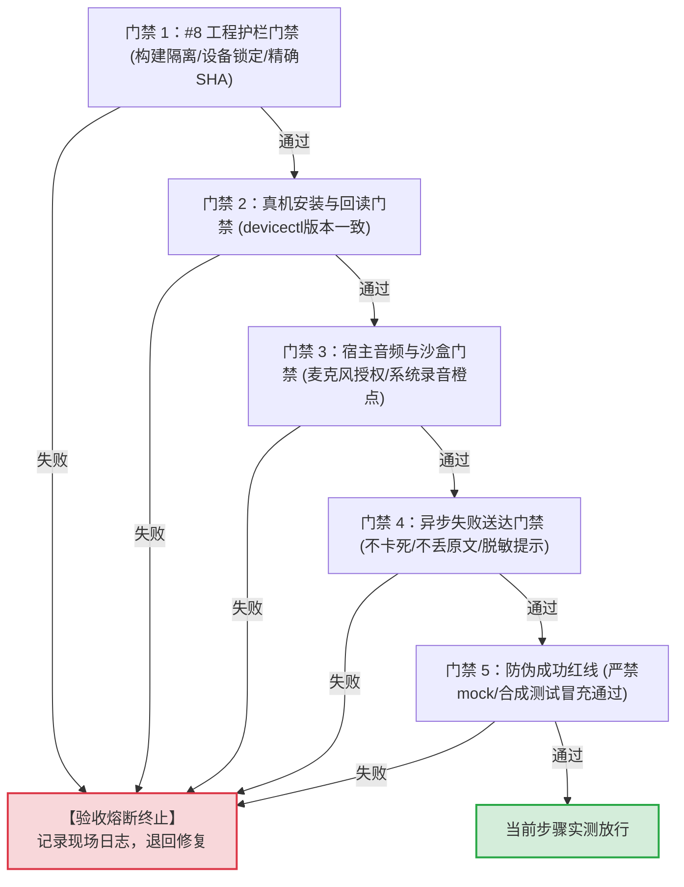

# 言出文随（voice-polish-keyboard）真机验收交接清单

> **交接使用说明**：本清单供后续具备物理真机与受控测试环境的人员按序执行。本文件基于第二轮只读材料（包含 [INDEX.md](README.md)、[03b-言出文随验收审查-完整版.md](03b-言出文随验收审查-完整版.md)、[06-交叉审校纠错清单.md](input/round2-context/06-交叉审校纠错清单.md) 及 PR/Issue 记录）整理，**绝非**本轮已实测通过的记录，亦**不是**生产发布或 App Store 上架清单。

---

## 一、现状边界（只读材料结论，非本轮实测）

依据 [INDEX.md](README.md)、[pr-12.md](https://github.com/evan188199-tech/voice-polish-keyboard/pull/12)、[comments-12.md](https://github.com/evan188199-tech/voice-polish-keyboard/issues/12) 与 [personal5_issue.md](https://github.com/srxAI/personal/issues/5) 的只读审查记录，当前代码与设备基线边界如下：

1. **PR #12 状态与分支基线**：
   - **PR 状态**：PR #12 为 **Draft（草稿）**，**未合并（merged=False）**，且最新提交暂无 CI Actions 运行记录。
   - **Head 分支与提交**：分支为 `codex/polish-integration-20261117`，最新 HEAD 提交为 `1ff27f8d1f3e783044d87ab454f208d50dec9be6`（包含 URL 兼容路径修复，与本地源 `c574db4` 具有相同的 Git tree `6a577728b22df8abd4d5a8bfa644f291c50b4f72`）。
   - **Base 分支**：明确为 `codex/voice-recovery-eval`（提交 `96e956ab99bf1e1b4eb369181161315d290feec5`），属于 Stacked Draft 架构；**基线明确不是 main**（因为 main 分支已有其他独立提交，严禁直接合入 main）。
2. **历史目标 SHA 与权限约束**：
   - Codex 核心实现分支 `codex/voice-first-ios-keyboard` 的历史目标 SHA 为 `7e5f86b1c691f2f43a67ec6f44fc3d7f9d8da9ef`。此前推送该 SHA 时曾出现 GitHub HTTP 403 权限拒绝。
   - **防伪红线**：后续操作必须以已保全的真实提交与分支为准，**严禁另造不同内容或重新生成的提交来冒充该目标 SHA**；严禁建议或尝试利用旁路绕过 403 权限。
3. **物理设备与安装版本脱节事实**：
   - 目标测试机 iPhone 16e 当前原位安装的产物版本为 **build15**（对应提交 `cbc08fe` / `4a7228c`）。
   - 最新包含 URL 兼容修复的提交 `1ff27f8` **尚未打包签名，尚未安装到 iPhone 16e**。
   - 用户在 16e 上点击“测试模型”时报错，已证实原因为配置了**私网域名**导致 DNS 解析失败，Mac 本地系统解析亦失败；该私网网络与解析阻断目前**尚未解决**。
4. **假成功判定红线**：
   - 依据工程护栏规范，**以下指标全部严格不等于真机宿主键盘验收通过**：
     - 设备回读版本 `build15` 或普通主 App 成功启动；
     - iPhone 16e 上跑通的 21 项或 23 项“原生设备合成 XCTest”（仅为脱机构造的逻辑与数据状态回归）；
     - 单元测试全绿、Swift 语法检查通过、本地 Mock 测试通过；
     - 后台进程 / 连接器状态显示“任务已启动”或“Connected”。
   - 真人对着物理麦克风口述、调用真实外部模型润色并向第三方宿主键盘输入框直接插入文字草稿的端到端真实操作，在物理真机上的执行次数**严格为 0**。

---

## 二、验收前核对清单（Pre-flight Checklist）

在开展任何物理真机操作前，执行人员必须逐一静态复核以下准备项：

| 核对维度 | 核对要点与标准 | 必须杜绝的违规行为 | 依据出处 |
|---|---|---|---|
| **设备与系统** | 1. 目标机必须为指定的物理 iPhone 16e，通过 USB 有线配对连接 Mac； 2. 设备开启开发者模式，屏幕保持解锁，核验系统状态 `passcodeRequired=false`； 3. Mac 构建机可用磁盘空间必须 $\ge 3.0\text{GiB}$（当前仅剩约 2.7GiB，须提前清理过期缓存，防止编译断流）。 | 严禁在未经授权的他人设备或未登记测试机上安装；严禁依赖无线不稳定网络连接调试。 | [issue-7.md](https://github.com/evan188199-tech/voice-polish-keyboard/issues/7) [comments-12.md](https://github.com/evan188199-tech/voice-polish-keyboard/issues/12#L49) |
| **构建产物隔离** | 1. 严格执行 [#7](https://github.com/evan188199-tech/voice-polish-keyboard/issues/7) 与 [#8](https://github.com/evan188199-tech/voice-polish-keyboard/issues/8) 门禁，使用 `mktemp -d` 创建独立 DerivedData 路径（如 `/tmp/vpk-build-XXXXXX`）； 2. 构建命令必须显式指定目标 Scheme、Configuration、明确的开发团队（Development Team）及 Bundle ID； 3. 安装采用 `xcrun devicectl` 原位更新。 | 严禁使用共享默认 DerivedData 导致产物串包；严禁脚本自动选择首台连接设备；严禁自动更新 provisioning profile 或自动注册新设备。 | [issue-7.md](https://github.com/evan188199-tech/voice-polish-keyboard/issues/7) [issue-8.md](https://github.com/evan188199-tech/voice-polish-keyboard/issues/8) |
| **模型与端点** | 1. 明确被测模型端点网络环境（私网 VPN vs 公网 HTTPS）； 2. 仅在网络路由与 DNS 解析验证成功后才发起连通请求； 3. 核对端点路径格式（确认 URL 修复逻辑生效，显式版本根与完整路径不被错误追加重复 `/v1`）。 | 严禁在私网 DNS 报错未解决时强测外部模型；严禁将网络不可达或域名失效包装为“模型不兼容”；严禁输出或记录 API Key / 凭据。 | [comments-12.md](https://github.com/evan188199-tech/voice-polish-keyboard/issues/12#L58-L66) |
| **系统权限** | 1. 主 App 麦克风录音权限必须在弹窗中显式点击“允许”； 2. 系统设置（设置 → 通用 → 键盘 → 键盘 → 添加新键盘 → 言出文随）必须正确添加，且开启“允许完全访问（Full Access）”。 | 严禁在未授予 Full Access 时进行跨进程网络通信测试；必须明确提示权限缺失补救指引。 | [03b-言出文随验收审查-完整版.md](03b-言出文随验收审查-完整版.md#L100-L107) |
| **录音与宿主沙盒** | 1. 明确认识 iOS 平台限制：依据 Apple 规范，Keyboard Extension 处于独立沙盒，**无权直接调用物理麦克风**； 2. 完全访问（Full Access）不包含麦克风权限；音频录制必须依托主 App 或跨进程共享； 3. 验收宿主首选系统自带空白“备忘录（Notes）”，避开密码输入框（`isSecureTextEntry`）。 | 严禁假定键盘扩展可原生静默录音；严禁使用私有 API（如 `AppSwitcher.swift`）绕过系统限制；安全输入框降级为系统原生键盘属于预期表现。 | [03b-言出文随验收审查-完整版.md](03b-言出文随验收审查-完整版.md#L109-L117) [issue-6.md](https://github.com/evan188199-tech/voice-polish-keyboard/issues/6#L44) |
| **数据与安全红线** | 1. 测试语料全部采用公开或虚构的标准验收设计样本； 2. 本地词库仅启用脱敏测试词典，排除真实私有旅游素材。 | **严禁采集、读取或上传真实用户的私人录音、真实姓名、私人笔记、账号凭证或生产密钥。** | [issue-5.md](https://github.com/evan188199-tech/voice-polish-keyboard/issues/5) [INDEX.md](README.md) |

---

## 三、逐步真机操作与证据字段清单

执行人必须按以下 6 个步骤在 iPhone 16e 宿主环境中执行，**每一步均须严格归档对应的截图或录屏证据字段**：

### 步骤 1：打开宿主键盘并按住说话上屏（基本听写全链路）
- **测试前置**：打开系统自带“备忘录（Notes）”App，新建空白笔记，点击正文使光标聚焦在编辑区。
- **操作流程**：
  1. 点击系统输入框呼出键盘，切换至“言出文随”第三方键盘；
  2. 单点或按住底部中央 `Speak` 按钮，观察系统状态栏顶部是否出现**橙色麦克风录音圆点**，键盘界面是否呈现平滑录音波形动画；
  3. 清晰口述标准测试句：“明天早上十点联系供应商确认周五交货，另外预算不要超过三千块”；
  4. 再次单点 `Speak` 结束录音；
  5. 观察端侧 ASR 转写及文本整理后，文本是否通过 `textDocumentProxy` **直接插入到备忘录光标位置**。
  6. 检查交互行为：**绝不强制弹出全屏预览确认遮罩**；**绝不自动触发任何“发送”操作**（纯草稿插入）。
- **必须记录的证据字段**：
  - `EV-01-REC`：**真机无剪辑完整录屏**（必须连续包含：调起键盘 → 按下 Speak 与波形出现 + 顶部系统橙色录音圆点 → 停止录音 → 文本直接落入光标位置）；
  - `EV-01-IMG`：备忘录插入文本后的全屏高清截图；
  - `EV-01-LOG`：设备 syslog 脱敏日志（包含音频捕获启动、ASR 耗时与插入完成事件，无用户音频明文）。

### 步骤 2：异步失败是否送达键盘（[#9](https://github.com/evan188199-tech/voice-polish-keyboard/issues/9) 交付契约与失败处理）
- **测试前置**：在主 App 设置中配置一个可复现网络异常的环境（例如配置一个无效的测试域名，或在飞行模式下断开外部连接）。
- **操作流程**：
  1. 在备忘录中调起键盘，点击 `Speak` 口述短语并结束；
  2. 触发异步外部润色请求；
  3. 观察网络失败发生时键盘状态机的流转：
     - 验证是否在超时或失败后**立即解除 `isBusy` 占用**，绝不能无限期处于转圈卡死状态；
     - 验证失败结果是否按任务快照（Task Snapshot）正确送达键盘并展示脱敏错误类别（如“DNS解析失败”或“网络请求超时”，绝对不泄漏 URL、Token 或异常堆栈）；
     - 验证本地 SenseVoice 识别出的原始文本是否**完整保留在输入框或草稿缓冲区**，绝不允许因外部润色失败而清空或吞掉用户已说文字；
     - 连续发起第二段口述，验证前序失败不阻塞后续任务，不存在重复插入（At-most-once 交付）。
- **必须记录的证据字段**：
  - `EV-02-IMG`：键盘展示脱敏错误分类提示的界面截图（证明错误明确送达且未泄露凭据）；
  - `EV-02-REC`：失败后本地原始文字完好保留并可正常继续编辑的操作录屏；
  - `EV-02-LOG`：脱敏任务状态快照日志（核验状态为 `failureFallback`，且请求 ID 正确消费闭环）。

### 步骤 3：长段语音保真整理（[#2](https://github.com/evan188199-tech/voice-polish-keyboard/issues/2)，注：外部声明需独立核证）
- **背景核验提醒**：材料核实表明，Codex 曾建议 Cursor 认领长段保真测试文件（`Tests/LongFormFidelityLinux/main.swift` 等），但 **Cursor 至今未回复确认**。Cursor 或他人对长段保真算法完成度的口头声称必须视为未核实，执行人必须在真机上独立验证！
- **操作流程**：
  1. 在备忘录中呼出键盘，连续口述一段包含逻辑并列、否定词、数字与日期的长段文本（时长约 30–45 秒）：
     > “第一联系供应商核实周五交货时间，第二跟财务确认预算不要超过三千五百元整，第三下午两点半召开线上会议，切记不要更改合同条款。”
  2. 结束录音，检查本地格式器（`FaithfulTextFormatter`）输出：
     - **数字与时效保真**：核对“周五”、“三千五百元整”、“两点半”是否准确保留；
     - **否定语义绝对保真**：严格核查“不要超过”、“切记不要更改”中的**否定词是否被完整保留**，绝不允许大模型或规则格式器将其删改或变成肯定式；
     - **排版分段**：核对是否按“第一/第二/第三”自然清晰分段或列出清单；
     - **标点撤销**：核对本地提供的句末标点建议是否可由用户主动撤销。
- **必须记录的证据字段**：
  - `EV-03-DIFF`：真人原始发音文字与宿主最终落字逐字比对表截图；
  - `EV-03-IMG`：长段排版及标点撤销按钮展示截图；
  - `EV-03-REC`：长段语音录制至排版呈现的真机操作录屏。

### 步骤 4：口述纠错只改目标字词（[#3](https://github.com/evan188199-tech/voice-polish-keyboard/issues/3) 针对性核查）
- **操作流程**：
  1. 在备忘录中呼出键盘，点击 `Speak` 录音；
  2. 口述标准纠字设计句：“明天联系小明，小明是黄晓明的晓明”；
  3. 再次单点结束录音；
  4. 检查文字落地结果：
     - 目标字词必须被准确纠正为“明天联系晓明”；
     - 后半段纠字意图说明话术“小明是黄晓明的晓明”**绝对不能进入最终正文**；
     - 若遇复杂不可分歧的字词，验证是否按规则保留原文并提示手动确认，绝不强行猜测替换。
- **必须记录的证据字段**：
  - `EV-04-IMG`：备忘录中只包含“明天联系晓明”正文的高清截图；
  - `EV-04-LOG`：`SpokenCorrection` 意图解析日志（证明识别出纠字指令并成功剔除修饰语）。

### 步骤 5：可编辑地名词典候选纠错（[#4](https://github.com/evan188199-tech/voice-polish-keyboard/issues/4) 针对性核查）
- **操作流程**：
  1. 进入主 App 词典管理界面，确认已勾选启用特定测试地名（如粤港澳/潮汕旅游地名：“广济桥”、“牌坊街”、“南澳岛”）；
  2. 切回备忘录调起键盘，口述包含同音易错地名的短句（如口播“去潮州看广济桥和牌坊街”）；
  3. 检查键盘候选交互：
     - 验证词库策略 `PolishContextPolicy` 仅对用户显式授权的词条提供候选建议；
     - 验证候选词条在键盘上方以可确认标签形式呈现，用户点击后方可上屏；
     - **明确技术边界**：核查并记录词库后处理不影响 SenseVoice 的端侧原生识别率（明确其为纯文本后处理，非声学热词）。
- **必须记录的证据字段**：
  - `EV-05-IMG1`：主 App 词库授权开关与词条配置截图；
  - `EV-05-IMG2`：键盘弹出地名候选并确认上屏的截图。

### 步骤 6：翻译长按上滑选语言（[#6](https://github.com/evan188199-tech/voice-polish-keyboard/issues/6)，按修正后的正文规范执行）
- **规范唯一版本澄清**：
  > 依据 [comments-6.md](https://github.com/evan188199-tech/voice-polish-keyboard/issues/6#L30-L38) 及 [personal5_issue.md](https://github.com/srxAI/personal/issues/5#L21)，需求早期讨论中曾追加过“每次必须预览确认”的设计，但**用户随后明确拍板撤销强制预览门禁，决定全面沿用 Typeless iOS 官方主路径**，[issue-6.md](https://github.com/evan188199-tech/voice-polish-keyboard/issues/6#L11-L21) 正文亦已据此完成修订。**本次验收必须严格以修正后的正文为准，绝不执行已废弃的强制预览门禁！**
- **操作流程**：
  1. 在主 App 预先配置并保存目标语言列表（如 English、香港繁体中文）；
  2. 在备忘录光标处调起键盘，手指**长按底部 `Speak` 键（按压约 0.5 秒）并向上滑动**；
  3. 观察呼出的目标语言浮层面板，手指滑至“English”选项后松手；
  4. 保持录音状态，口述中文：“请把样品检查报告发给项目经理”；
  5. 单点 `Speak` 结束录音；
  6. 检查落地结果：
     - 翻译成功后，英文译文草稿（如 `Please send the sample inspection report to the project manager`）**直接插入到备忘录光标位置**；
     - **不强制弹出全屏确认对话框**，用户无需额外点击确认即可直接使用；
     - **绝不自动触发宿主 App 的“发送”按钮**；
     - 界面提供可选的“查看原文 / 撤销恢复原文”入口；
     - 手势防误触测试：长按但未上滑选中语言直接松手，验证不误启动翻译、不破坏普通点按录音。
- **必须记录的证据字段**：
  - `EV-06-REC`：**真机长按上滑手势与全链路录屏**（必须完整呈现：长按 Speak 键 → 上滑呼出语言选择盘 → 选中 English 松手录音 → 点 Speak 结束 → 英文译文直接写入光标处）；
  - `EV-06-IMG`：备忘录直接插入译文全屏截图及原文回退按钮截图。

---

## 四、失败即停的门禁规则（Fail-Fast Gates）

在执行上述真机验收过程中，凡触碰以下任一红线门禁，**测试人员必须立即中止验收流程，不得继续，不得判定通过**：

1. **[#8](https://github.com/evan188199-tech/voice-polish-keyboard/issues/8) 工程护栏与部署门禁（Stop on Guardrail Failure）**：
   - **只读诊断门禁**：执行环境诊断必须严格分开报告网络、DNS、TCP、TLS、认证及 Git ref；严禁输出任何私钥凭据。若诊断脚本发现网络或 TLS 阻断，严禁盲目修改配置继续测试。
   - **精确推送核验门禁**：若涉及代码检出，必须严格核验本地工作区无脏文件，远端 Git ref 必须精确相等（目标 HEAD `1ff27f8d1f3e783044d87ab454f208d50dec9be6`）；**严禁使用任何哈希不符的提交冒充目标基线**。
   - **设备部署门禁**：构建必须使用隔离的临时目录（`mktemp -d`）；部署必须显式指定目标设备 UDID；禁止自动选择首台连接设备，禁止自动注册设备。若构建脚本试图使用共享 DerivedData，**立即停机**。
2. **异步失败未送达键盘门禁（Stop on Undelivered Failure）**：
   - 依据 [#9](https://github.com/evan188199-tech/voice-polish-keyboard/issues/9)，当网络断开、DNS 报错或模型超时时，键盘若发生以下任一情况，**立即判定为致命失败并停机**：
     - 键盘界面无限期显示“处理中 / 正在润色”转圈，`isBusy` 未释放导致后续输入被永久锁死；
     - 失败被静默吞掉，键盘无任何错误提示却直接恢复空闲；
     - 失败导致用户原本转写成功的本地草稿文字丢失或被清空；
     - 发生重复插入或乱序插入。
3. **假成功冒充通过门禁（Stop on Fake Pass）**：
   - 严禁将 Xcode 模拟器 144 项全绿冒充真机宿主测试通过；
   - 严禁将 iPhone 16e 运行的 23 项“脱机设备合成 XCTest”冒充真人麦克风与键盘输入通过；
   - 严禁将后台进程或连接器的“Connected / 任务已启动”冒充具备真实执行能力；
   - 凡出现使用合成脚本测试代替真人操作、未录制物理屏幕即出具“已通过”报告者，**一票否决**。

---

## 五、仍待核、不得当作已证实主张的条目清单

在 [03b-言出文随验收审查-完整版.md](03b-言出文随验收审查-完整版.md) 及前期讨论中，部分架构细节与技术假说**缺乏直接运行证据或已被阻断**。执行人员**必须将其列为【待核 / 待证】，绝不能在验收报告中写成“已修复”或“已有事实”**：

| 待核条目 | 涉及模块 / 假说内容 | 材料中的真实受阻事实（为何不能当已证实） | 真实状态口径 |
|---|---|---|---|
| **38 个 wheel 包与离线依赖** | 云端声称已准备 38 个 Mac arm64 CPython 3.14 wheel 包（大小 114,436,392 字节，SHA256: `0208ca82c263de3b97afadcaefd09f2e4eb3ac94442f66c96c7cdb40f6e4c360`）。 | Mac 消费端调用官方 Library 转移助手返回 `download failed`，文件**从未送达 Mac**；Mac 本地哈希校验、离线 `pip check`、MLX 导入及 Metal 运算**全部未执行**。 | **【待核 / 传输阻断】** 不得宣称评测运行库已就绪。 |
| **键盘扩展麦克风与录音架构** | 架构讨论中设想的“主 App + 隐藏画中画（PiP）后台保活录音”或“切 App 录音”。 | Apple 官方明确键盘扩展无麦克风权限；PiP 保活录音方案面临 App Store 审核被拒高风险；工程中仍残留 `AppSwitcher.swift` 私有 API。真机沙盒下后台音频桥接至今未跑通。 | **【待核 / 架构未决】** 严禁将 PiP 录音宣传为已实现。 |
| **App Group 数据容器一致性** | 主 App 与 Keyboard Extension 通过 App Group 共享用户词库与状态。 | 仅在模拟器及代码级有配置，真机真实 App Group 跨进程容器在被宿主调用时的读写延迟与一致性缺乏真机日志证据。 | **【待核 / 缺乏真机日志】** |
| **Cursor 在 [#2](https://github.com/evan188199-tech/voice-polish-keyboard/issues/2) 的工作确认** | Codex 建议 Cursor 认领 `Tests/LongFormFidelityLinux/main.swift` 与 `scripts/check_longform_fidelity.sh`。 | Cursor **至今未在 issue 中回复确认**，未建立分支，未拉取代码；长文测试文件处于冻结状态。他人关于长段保真外部验收的口头声称缺乏回包支持。 | **【待核 / 协作悬空】** 不得将他人声称当已证实。 |
| **Mac 代理 13130 TLS SSLEOFError** | 本地 13130 端口（verge-mihomo）代理连通性。 | 虽有进程监听且 TCP CONNECT 建立成功，但随后 TLS 握手立即报 `SSLEOFError` errno 8（curl 35 退出）；系统代理 7897 端口无任何 TCP 监听。上游分流与断开根因未查清。 | **【待核 / 待排障】** 严禁写成代理或网络已修复。 |
| **模型私网域名解析失败** | iPhone 16e 与 Mac 请求用户配置的模型端点报错。 | 经查为配置了私网域名，Mac 本地系统解析亦失败；iPhone 与 Mac 的内网 VPN / Tailscale 路由及权威 DNS 状态未核实。 | **【待核 / 网络阻断】** 严禁写成端点已打通。 |
| **键盘扩展 30MB 内存上限** | 端侧 SenseVoice INT8 模型加载与运行。 | iOS 对键盘扩展施加严格的 30MB 内存上限；大模型或转写框架加载是否会触发系统 Jetsam 机制强杀闪退，真机物理数据为 0。 | **【待核 / 稳定性悬空】** |
| **开源许可合规与 LICENSE 文件** | 仓库筹备迁移至 srxAI 组织。 | 仓库根目录**仍缺失 `LICENSE` 文件**；FunAudioLLM、Sherpa-onnx 等第三方模型许可证合规审计尚未正式闭环。 | **【待核 / 法务未决】** 严禁宣称合规已完成。 |

---

## 六、交接执行禁令（Non-Goals & Restrictions）

为防止后续执行人员越权操作或破坏项目既有分支状态，特别声明以下红线禁令：

1. **严禁写成生产发布或 App Store 上架清单**：本项目当前处于集成测试与工程护栏排障阶段，绝不具备生产发布条件。
2. **严禁建议或尝试绕过 HTTP 403 权限**：403 属于服务端写权限控制，必须按规范申请合规授权，严禁通过非常规手段破解、绕过或改动仓库鉴权。
3. **严禁修改 SHA 或另造提交冒充历史目标**：任何提交必须具备真实 Git tree 与可追溯记录，严禁通过 `git commit --amend` 或新建空提交伪造特定历史 SHA。
4. **严禁建议直接合并 Draft PR #12**：PR #12 为基于 recovery 分支的 Stacked Draft，main 分支已存在独立提交且未进行冲突核对；未通过端到端真机验收与 CI 门禁前，严禁合并 PR #12。

---

## 七、非结论说明

> **非结论声明（Non-conclusion Disclaimer）**  
> 本清单是一份面向未来真机执行的前瞻性**交接设计规范（Handover Design）**。在本轮任务中，本助手仅阅读了仓库只读材料与上下文审校文档，**严格未连接物理设备，未执行任何 Xcode 原生构建命令，未在物理 iPhone 16e 或其他移动设备上做任何真机点击、麦克风拾音、键盘输入或网络请求**。所有步骤均须等待具备物理真机与合规环境的工程师实际操作并采集有效证据后，方可出具正式验收结论。
